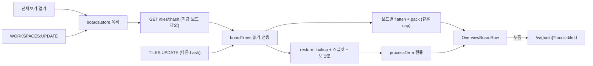

# REF — 보드 미리보기 (전체보기에 다른 보드 줄)

> 2026-10-14 신설. ③ 파트(보드 미리보기). 보드(작업 공간 여러 개) 개념 → `REF-workspace.md`(희망안·시안) / 전체보기 모드 규칙 → `REF-node-ui-overview.md` "전체보기 모드" / 이력 → `history/board-preview.md` / 현재 진행 → `CURRENT.md`.

**상태: 마감(2026-10-15, 커밋 `52ae8b9`) → `INDEX-board-preview.md`.** 미리보기-1(다른 보드 트리)~미리보기-6(확인) 격리 헤드리스 31/31 + 닫을 때 처리 = 중간안 15/15 + 사용자 확인 목록 1~7 확인.

## 시안 (2026-10-14)
캔버스 하나에 A~E: https://claude.ai/artifact/KSBX7CyuzQP3soj9tWnQd9
| 시안 | 내용 | 결과 |
|---|---|---|
| A 카드 줄 | `/` 루트 폴더 타일 안 카드(활동 점·개수) | 보류 |
| B 보드 타일 | `/`에 보드 전용 타일, 배치 축소도 | 보류 |
| C 출력 축소본 | 카드 안에 터미널 마지막 줄 | 보류 |
| D 헤더 메뉴 확장 | `BoardMenu` 드롭다운에 활동 점·배치도 | 보류 |
| **E 전체보기 보드 줄** | 기존 전체보기에 다른 보드를 줄로 추가 | **채택**(사용자 "전체 보기에 보드별로 보여주는것도 괜찮아 보인다") |

## 번호-이름 대응 · 확정 (2026-10-14 사용자 "네 추천대로")
| 번호(이름) | 확정 |
|---|---|
| EV1(다른 보드 출력) | **실제 타일처럼 출력이 움직임** — 열 때 스냅샷으로 채우고 이후 출력 반영. 아래 "알게 된 것" 때문에 원래 뜻("열린 동안만 구독")에서 "열 때 xterm 등록"으로 바뀜 |
| EV2(보드 쌓는 방향) | PC(가로 한 줄 전체보기) = 보드마다 한 줄, 위아래로 쌓음 / 폰 세로(세로 한 줄) = 긴 축에 이어 붙이고 보드 사이에 이름표 |
| EV3(다른 보드 크기) | 지금 보드와 같은 축소 비율(`- n% +` 하나로 조절) |
| EV4(지금 보드 위치) | 맨 앞 + 테두리 강조 |
| EV5(누르면) | 그 보드로 이동 + 그 타일 active(그 Grid로) |
| EV6(보이는 범위) | 어느 보드에서 열어도 계정의 모든 보드 (희망안 "`/`에서만"보다 넓힘) |

## 알게 된 것 (구조안의 전제)
| 사실 | 근거 코드 | 영향 |
|---|---|---|
| 서버는 탭 소켓을 계정이 볼 수 있는 **모든** 살아 있는 process 토픽에 이미 구독시킴 | `subscribe.go` `subscribeLiveProcesses`(접속 때) · `subscribeViewers`(exec·재접속 때) | 다른 보드 출력은 **이미 모든 탭에 옴** → 서버 구독 변경 불필요. EV1의 부담은 서버가 아니라 프론트 xterm 수 |
| 등록 안 된 uid의 출력은 보관(64KB·10초) | `processTerm.store.ts` `DATA` 처리 · `HOLD_BYTES`·`HOLD_MS` | 등록 = 기존 `restore`(조회 + 스냅샷 + 그 off 뒤 보관분)를 그대로 쓰면 됨 |
| 크기 소유가 아닌 탭의 xterm은 PTY 크기(cols·rows)를 따름 | `processTerm.store.ts` `PROCESS:UPDATE` 처리(`!owners_[uid]`면 `term.resize`) | 다른 보드 터미널은 이 탭이 크기를 바꾸지 않음(크기 우선권 후보 = 그 보드를 보는 탭) |
| 전체보기 = 실제 타일을 실제 px로 그린 뒤 `scale` | `TileStrip.vue` `layoutStyle` · `tileGrids.store.ts` `overview` | 다른 보드도 같은 `cap`으로 `pack` → 같은 방식으로 축소 |
| `TileFrame`은 `useTileTree`·`useTileGrids`를 inject | `TileFrame.vue` | 다른 보드 타일엔 그대로 못 씀 → 읽기 전용 가벼운 틀 필요 |
| 보드 전환 때 xterm·등록은 남김 | `REF-workspace-front.md` "구현 중 정한 것" | 열고 닫을 때 등록을 남겨도 기존 규칙과 같음 |

## 데이터 흐름

## 구조안 — 작업 단위 (미리보기-1~6, 코드 없음)
| 작업 단위 | 파일(예상) | 내용 |
|---|---|---|
| 미리보기-1(다른 보드 트리) | `feature/node/store/boardTrees.store.ts`(새) · `tile.api.ts` | 전체보기를 열면 `boards.store` 목록 순서대로 `getTiles(hash)`(지금 보드 제외) → 읽기 전용 트리 맵. 열린 동안 `TILES:UPDATE` 중 **다른 hash**도 받아 갱신(지금 `tileTree.store`는 버림), `WORKSPACES:UPDATE`로 보드 추가·삭제 반영. 닫으면 트리 버림. 서버 변경 없음(보드 수가 적어 hash마다 요청) |
| 미리보기-2(터미널 등록) | `terminalRestore.hook.ts` · `processTerm.store.ts` | 다른 보드 트리의 터미널 uid를 기존 `restore`로 등록. **`treeUids`·`prune` 기준에 다른 보드 uid 포함** — 안 하면 `sync`의 `prune`이 다른 보드의 끝난 터미널 xterm을 지움. 닫은 뒤에도 등록은 남김(보드 전환 규칙과 같음) |
| 미리보기-3(Grid 파생) | `tileGrids.store.ts` | `flatten → 최소화 제외 → pack(cap)`을 함수로 빼서 지금 보드·다른 보드가 같이 씀. 위치 번호도 보드별 |
| 미리보기-4(그리기) | `TileStrip.vue` · `OverviewBoardRow.vue`(새) · `OverviewTile.vue`(새) | 전체보기 때 지금 보드 줄(기존 그대로, 테두리) 뒤에 다른 보드 줄. PC = 보드마다 줄(이름·요약 왼쪽) 위아래 / 폰 = 이어 붙이고 이름표. 터미널 = 기존 xterm 핸들을 꽂음(입력 없음), 폴더 = 머리 줄 + 흐림. 축소 비율 공유 |
| 미리보기-5(이동) | `OverviewTile.vue` | 다른 보드 타일 누름(Enter/Space 포함) = `router.push(boardPath(hash) + ?focus=<tileId>)` — `TileWorkspace.vue`의 기존 `?focus` 처리(트리에 들어오면 activate) 재사용 |
| 미리보기-6(확인) | 격리 헤드리스 | 보드 3개 + 터미널: 열기·출력 갱신·스냅샷 이음매·누르면 이동·다른 탭 변경 반영·보드 삭제·폰 크기·닫은 뒤 prune 안 됨 |

**의존 순서**: 미리보기-1 → 미리보기-3 → 미리보기-2 → 미리보기-4 → 미리보기-5 → 미리보기-6

## 위험 · 확인할 것
- xterm DOM은 한 자리에만 붙음 — 다른 보드 터미널은 지금 보드에 없으므로 겹치지 않음. 닫을 때 떼고 다음에 열 때 다시 붙임(재발 방지: 기존 "재마운트 금지" 주석과 같은 문제 — xterm은 스토어가 가짐)
- 터미널이 많으면 열 때 스냅샷 요청이 몰림(보드 수 × 터미널 수). 처음엔 그대로, 느리면 묶음 API 고려
- 다른 보드 터미널의 active 배지·위치 알림은 그리지 않음(읽기 전용)
- `REF-node-ui-overview.md` "거르기 = 안 거름"과 같이 다른 보드도 배치 그대로

## 구현 (2026-10-14, 사용자 "내 확인이 필요할때까지 진행해줘")
| 파일 | 내용 |
|---|---|
| `feature/node/store/boardTrees.store.ts`(새) | 미리보기-1(다른 보드 트리): `open()`/`close()`, 지금 보드를 뺀 목록 순 `getTiles(hash)`, 열린 동안 다른 hash의 `TILES:UPDATE`(불러오는 중이면 `early`에 보관) · 목록 변화 · 재연결 재조회. `list`(보드·트리·오류) · `uids`(다른 보드 터미널) |
| `pages/index.vue` | `provideBoardTrees(tileTree.hash, boards)` + `useTerminalRestore(..., boardTrees.uids)` |
| `feature/node/hook/terminalRestore.hook.ts` | 미리보기-2(터미널 등록): 세 번째 인자 `others` — `treeUids`에 합침(등록·`prune` 기준) |
| `feature/node/store/tileGrids.store.ts` | 미리보기-3(Grid 파생): `layoutOf(tiles, rootId, cap)` 함수로 빼서 지금 보드·다른 보드 공용, `otherBoards`(보드별 grids·위치 번호·로딩·오류). `enterOverview`/`leaveOverview`/언마운트에서 `boardTrees.open/close`. 열 때 스크롤 = 첫 `.cell` 기준(앞에 이름 칸이 생겨도 0) |
| `feature/node/component/TileStrip.vue` | 미리보기-4(그리기)·미리보기-5(이동): 지금 보드 cell을 `.board > .board-cells`로 감쌈(**평소 `display: contents`** — 두 모드 모두 두어 재마운트 없음) + 다른 보드 줄. strip은 전체보기 때 세로로 보드를 쌓음. `row.multi` = 보드마다 가로 줄(이름 칸 140px 왼쪽) / `col` = 보드 안도 세로 + 이름표 위. 보드가 여럿이면 세로 휠을 가로로 바꾸지 않음. 다른 보드 타일 누름·Enter/Space = `router.push(focusPath(board, tileId))` |
| `feature/node/component/tile/OverviewTile.vue`(새) | 다른 보드 타일(읽기 전용): `.ov-name`(위치 번호·이름·상태 칩, 역배율) + 터미널 = 기존 `ProcessTerminal`(`inert`) / 폴더 = 흐리게 |

- 서버 변경 없음. 전체보기를 닫을 때 처리는 아래 "확정 — 전체보기를 닫을 때"(중간안, 2026-10-15). 처음 구현(2026-10-14)은 닫아도 실행 중 xterm을 남겼음

## 확인 결과 (미리보기-6(확인), 2026-10-14)
격리(임시 DB `nexus_bp_tmp` + supervisor 5051 + worker `bp-dev` + 프론트 3001, 끝난 뒤 종료·삭제). 스크립트 = scratchpad `pw/bp.mjs`·`pw/bp2.mjs`(재부팅 시 사라짐, 명세 → `REF-test-scripts-1014.md` "2026-10-14 보드 미리보기"). **31/31 통과** + 따로 1개.

| 묶음 | 항목(전부 통과) |
|---|---|
| 평소 | 감싸는 요소가 배치를 안 바꿈(첫 cell 폭 = strip 안쪽 폭, `.board` = `contents`) |
| 열기 | 보드 줄 3개 · 순서(지금 보드 먼저, 목록 순) · 지금 보드 강조 · 열 때 스크롤 0 · 보드2 타일 = 폴더 1 + 터미널 2 · 터미널 없는 보드 요약 |
| 출력 | 스냅샷으로 앞부분(`tick-B 0`) · 이음매 중복 없음 · 열린 동안 출력 갱신 · 끝난 터미널 종료 줄·DONE 칩 · 요약 "터미널 2 · 실행 중 1" |
| 실시간 | 열린 동안 다른 보드 트리 변경(API PUT) 반영 · 보드 삭제 반영 |
| 닫기·다시 열기 | 닫으면 보드 줄 없음 · 다른 보드 xterm이 화면에서 떨어짐 · 다시 열면 앞부분 유지 + 새 줄 · 끝난 터미널도 다시 보임 · 닫혀 있는 동안 쌓인 줄이 다시 열고 100ms 안에 그려짐(`bp2.mjs`, 4초마다 출력하는 터미널) |
| 이동 | 다른 보드 터미널 누름 → `/w/{hash}` + 그 터미널 active + 전체보기 닫힘 + 터미널 화면 그대로 |
| 다른 보드에서 | 보드2에서 열면 기본 보드가 다른 줄 + 기본 보드 터미널 출력 보임(EV6(보이는 범위)) |
| 폰(400×820) | 보드 안 Grid 세로 · 이름표 위 · 가로 스크롤 없음 |
| 보드 하나 | `multi` 없음 · 이름 칸 없음(예전 그대로) |
| 전체 | 콘솔 오류 없음 |

- 1차 실행에서 "다시 열면 이어서"가 실패로 나왔던 것은 스크립트가 다시 연 직후 바로 읽어서(이전에 그려진 줄) — 기다린 뒤 읽기로 고쳐 통과, `bp2.mjs`로 실제 지연 100ms 이하 확인

## 사용자 확인 목록
| # | 확인할 것 |
|---|---|
| 1 | 보드 2개 이상에서 전체보기 → 지금 보드가 맨 위(파란 테두리) + 다른 보드가 아래 줄로, 이름·요약이 왼쪽에 |
| 2 | 다른 보드 터미널 출력이 전체보기 안에서 계속 움직임 |
| 3 | 다른 보드 타일을 누르면 그 보드로 가고 그 타일이 active |
| 4 | 폰에서 전체보기 → 보드가 세로로 이어지고 이름표가 위 |
| 5 | 축소 비율 `- n% +`가 다른 보드 줄에도 같이 적용 |
| 6 | 보드가 하나뿐인 계정은 전체보기가 예전과 같음 |
| 7 | (중간안) 전체보기를 닫았다 다시 열어도 다른 보드 터미널 내용이 그대로(스냅샷으로 다시 채워짐) |

## 확정 — 전체보기를 닫을 때 다른 보드 xterm (2026-10-15, 사용자 "중간안으로 가자")
**중간안 = 전체보기 때문에 새로 등록한 xterm만 닫을 때 지운다. 보드 전환으로 이미 있던 것은 남긴다.** 다시 열면 스냅샷으로 다시 채운다(처음 열 때와 같은 요청).

결정 근거(2026-10-14 질문 답변, 상세 → `history/board-preview.md`)
| 단계 | 내용 |
|---|---|
| 소켓 | 서버가 탭 소켓을 계정이 볼 수 있는 모든 실행 중 process 토픽에 이미 구독(`subscribeLiveProcesses`) — 전체보기와 무관, 네트워크 추가 비용 0 |
| xterm | 등록된 uid만 해석·버퍼(터미널마다 xterm + 1000줄, 대략 1MB 안팎). 그리기는 화면에 붙은 동안만 |
| 결론 | 실시간 자체는 비용이 작고, 걸리는 것은 "닫아도 남음" → 열린 동안 실시간 + 닫으면 지움. 기각: 지금(남김) / 스냅샷(멈춤, 임시 xterm·끝난 터미널 404 처리 필요) |

구현(`terminalRestore.hook.ts`만 — `boardTrees`·`processTerm` 변경 없음, 등록을 `boardTrees`로 옮기지 않음)
| 작업 단위 | 내용 |
|---|---|
| 중간-1(등록 출처 기억) | `reload`/`sync`가 조회 직전 `othersOnly` = 미등록 + 지금 보드 트리엔 없고 `others`에만 있는 uid를 고름 → 조회 뒤 등록된 것만 `viaOthers`에 기록 |
| 중간-2(놓아주기) | `release()`: `viaOthers`의 uid가 지금 보드 트리에 있으면 그 보드 소속 → 기록만 뺌 / `others`에도 없으면 `dispose` + 기록 뺌. `next()`에서 호출(uid 목록 변경 watch·조회 끝 `finally` 둘 다 거침) |

경계 상황(틀리면 깨지는 것)
- **`ready`일 때만 `release`**: 다른 보드 타일을 눌러 이동하면 `load()`가 `ready=false` + 빈 트리로 만든 뒤 `TileStrip` 언마운트에서 `close` → 그때 판정하면 이동할 터미널까지 지움. 새 트리를 받은 뒤 판정하면 지금 보드 소속이라 남음
- **조회 중 닫기**: 스냅샷 응답이 닫은 뒤 오면 그때 등록됨 → 조회 끝 `.then`에서 기록 + `finally -> next -> release`로 지움

## 확인 결과 (중간-3(확인), 2026-10-15)
격리(임시 DB `nexus_bp_tmp` + 5051 + worker `bp-dev` + 프론트 3001, 끝난 뒤 종료·삭제). 스크립트 = scratchpad `pw/mid.mjs`(명세 → `REF-test-scripts-1014.md` "2026-10-15"). 판정 = 다른 보드 터미널 B의 `GET /processes/snapshot/<uid>` 요청 횟수(등록될 때만 요청함). **15/15 통과**, 콘솔 오류 없음.

| 묶음 | 항목(전부 통과) |
|---|---|
| 열기·닫기 | 새로고침 직후 B 미등록(요청 0) · 열면 요청 1 + 출력 보임 · 닫고 다시 열면 요청 다시(지워졌음) · 줄 번호 빈틈·중복 없음 · 다시 연 뒤 출력 갱신 |
| 조회 중 닫기 | 스냅샷 응답을 붙잡은 채 닫고 놓음 → 다시 열면 요청 다시(늦게 등록된 것도 지움) |
| 누르고 이동 | 보드2로 이동 + 전체보기 닫힘 · 이동 뒤 요청 없음(지우지 않음) · 줄 번호 이어짐 |
| 보드 전환 것 | SPA로 보드2 진입 = 요청 1 → `/`에서 열기·닫기·다시 열기 모두 요청 없음(안 지움) · 출력 보임 |
