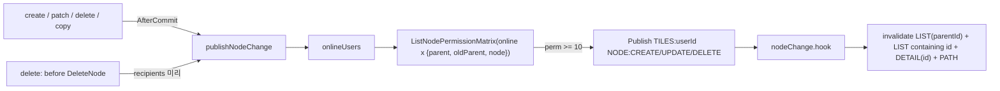

# REF — 폴더 목록 동기화 (node 변경 실시간 반영)

> 2026-10-12 신설. 이력 → `history/node-list-sync.md` / 실시간 push 원칙 → `REF-realtime.md` / 공유 판정 → `INDEX-process-share.md`(REF-process-share-db) / 현재 진행 → `CURRENT.md`
> 이 파트 = 열린 질문 4(NODE 동적 구독)·4⑤(폴더 목록 동기화)의 해소. **2026-10-12 사용자 확인·마감**

## 문제 (2026-10-12 사용자 제기)
- 공유 폴더에서 소유자가 만든 폴더가 받은 쪽에 바로 안 뜸. 스크립트·반대 방향(받은 쪽이 만듦)·같은 계정 다른 탭도 같음 — 새로고침 버튼만
- 원인: 서버는 `NODE:<parentId>`에 발행(`node.go` `publishNode`)하지만 **그 토픽을 구독시키는 코드가 없고, 프론트에 `NODE:*` 수신도 없음**

## 방향 = NB(계정 토픽으로 보내기) (2026-10-12 사용자 선택)
| | NA(펼친 폴더 토픽) — 기각 | NB(계정 토픽으로 보내기) — 채택 |
|---|---|---|
| 방식 | 폴더 타일 열 때 REST로 `NODE:<id>` 구독, 닫을 때 해지 | 노드가 바뀔 때 볼 수 있는 접속 계정을 판정해 `TILES:<userId>`로 보냄 |
| 공유 해제 | 구독도 같이 풀어야 함 | 보낼 때 판정이라 할 일 없음 |
| 재접속·탭 여러 개 | 다시 구독 | 계정 토픽은 접속 때 이미 구독 |
| 재사용 | 새로 | active 배지 RA3(받는 범위·경로)과 같은 방식(`onlineUsers` + `ListNodePermissionMatrix`) |

- 깊이 무관: 판정은 `node_permission` → `nearest_node_share`가 조상으로 올라가며 가까운 공유를 찾음(최대 64단계)
- **공유 루트 자신**이 바뀌면 부모(소유자 폴더)는 받은 쪽이 못 봄 → 노드 자신도 판정해야 함(받은 쪽에선 루트 목록에 보임, `ListSharedRoots`)

## 구조안 (2026-10-12 제시 · 2026-10-12 권장안대로 승인)

### 결정
| 결정 | 권장안 | 다른 안 |
|---|---|---|
| NS1(이벤트 종류) | 기존 `NODE:CREATE`/`UPDATE`/`DELETE` 3종 + payload = node 전체 유지(2026-07-16 결정 그대로). 바뀌는 건 토픽만 | 내용 없는 신호 1종(`SHARE:CHANGE`처럼) |
| NS2(받는 계정) | 접속 중 계정 × {부모, 옛 부모(이동), 노드 자신} 중 하나라도 보기(10) 이상 | 부모만(공유 루트 변경이 안 감) |
| NS3(판정 시점) | 생성·수정·복사·이동 = 커밋 뒤(옛 부모·노드 모두 아직 있음) / **삭제 = 트랜잭션 안 삭제 전**(커밋 뒤엔 노드가 없어 판정 불가) | 전부 커밋 전(롤백 시 헛판정) |
| NS4(프론트 반영) | 캐시 패치 없이 **무효화만**: `LIST(parentId)` + **캐시된 LIST 중 그 id를 담은 것 전부**(옛 부모 목록·루트의 공유 루트 자리를 payload 추가 없이 덮음) + `DETAIL(id)` + `PATH` | payload에 옛 부모·루트 여부 추가(계정마다 payload가 달라짐) |
| NS5(요청한 탭) | 요청한 탭도 받음 → 무효화 1회 더(GET 1번, 허용) | `tabId`로 거름(요청 헤더 전달 배선 추가) |
| NS6(재접속) | 소켓 재연결(CONNECTED) 때 `['NODE']` 전체 무효화(끊긴 동안 놓친 변경) | 안 함 |
| NS7(`SHARE:CHANGE`와 겹침) | 이동·삭제는 `reconcileAccess`가 이미 공유 계정에 `SHARE:CHANGE`(NODE 전체 무효화)를 보냄 → 겹쳐도 무효화라 그대로 둠 | 한쪽 제거 |

- 원칙 변화: MEMORY "실시간 push"의 "토픽 단위 = 펼친 폴더 `NODE:<parentId>`" + "라우팅 = DB 무접촉"이 **node 변경에 한해** "발행 시점 DB 판정 + 계정 토픽"으로 바뀜(process 출력은 그대로). 노드 변경은 드물어 판정 1회 비용은 무시. → 승인 시 MEMORY 개정
- 새 SQL 없음: `ListNodePermissionMatrix(user_ids, node_ids)` 재사용(없는 노드 = 0)

### 작업 단위
| 단계 | 할 일 | 주요 파일 |
|---|---|---|
| 동기화-1(서버 발행 대상) | `publishNodeChange(kind, node, nodeIds)` = `onlineUsers` × `ListNodePermissionMatrix` → 보기 이상 계정의 `TILES:<userId>`에 발행. 삭제용 `nodeRecipients(c, ids)`(tx 안, 삭제 전) 분리. create·patch(이동이면 옛 부모 포함)·delete·copy 4곳 교체. `nodeSubscribeTopic`·`publishNodeTopic`·`parentOrRoot` 제거 | `node.go`, `nodeCopy.go`, `subscribe.go` |
| 동기화-2(프론트 수신) | `nodeChange.hook.ts`(3종 `on` → NS4(프론트 반영) 무효화) + 재연결 시 전체 무효화. `pages/index.vue`에서 `useShareChange` 옆에 마운트. `useNodeQueryClient`에 "id를 담은 LIST 무효화" 추가 | `feature/node/hook/nodeChange.hook.ts`, `node.api.ts`, `pages/index.vue` |
| 동기화-3(확인) | 격리 실행(임시 DB + 5051). 아래 확인 항목 | — |

### 동기화-3(확인) 항목 (계정 A 소유 · B 편집 공유 · C 무관 · A 두 번째 탭)
- A가 공유 폴더 S 바로 아래 / S/x/y/z 깊은 곳에서 폴더·스크립트 생성 → B 목록에 바로 뜸, C는 이벤트 없음
- B가 S/x 안에서 생성·이름 변경·삭제 → A(두 탭 모두) 바로 반영
- S/x를 S 밖(A 전용 폴더)으로 이동 → B 목록에서 빠짐 / 다시 S로 → 뜸
- 공유 루트 S 이름 변경 → B 루트 목록 반영 / S 삭제 → B 루트에서 빠짐
- 복사(SH10(노드 복사))로 S 안에 넣기 → B에 뜸
- 소켓 끊었다 붙이기 → 끊긴 동안 변경 반영

## 구현 메모 (2026-10-12, 동기화-1(서버 발행 대상)·동기화-2(프론트 수신) 코드 · 동기화-3(확인) 격리 통과)
| 단계 | 구현 |
|---|---|
| 동기화-1(서버 발행 대상) | `node.go`: `publishNode(kind, node, parents...)` = 커밋 뒤 `nodeRecipients`(접속 계정 × `nodeJudgeIDs` = 노드 자신·부모·이동 전 부모, 보기 이상) → `publishNodeTo` = 계정마다 `TILES:<userId>`. patch는 `oldParent`를 넘김(이동 아니면 중복 제거). delete는 tx 안 삭제 전에 `recipients`를 구해 커밋 뒤 `publishNodeTo`. copy·create는 시그니처 그대로. `parentOrRoot`·`publishNodeTopic`·`nodeSubscribeTopic` 삭제, `messages.go` 주석 갱신 |
| 동기화-2(프론트 수신) | `node.api.ts` `invalidateChanged(node)` = `['NODE','LIST']` 중 키[2] = parentId(null → undefined = 루트) **또는** 캐시 데이터에 그 id가 있는 목록 + `DETAIL(id)` + `PATH` 전부. `nodeChange.hook.ts` = 3종 `on` → `invalidateChanged` + 재연결 때 `['NODE']` 전체(첫 연결은 거름). `pages/index.vue`에서 `useShareChange` 옆에 마운트 |
- 확인: `go build`·`go vet` 통과 / `vue-tsc` 통과
- 키 주의: 폴더 타일 목록 = `useListChildren(computed(nodeId ?? undefined))` → 캐시 키 `['NODE','LIST', undefined]`(vue-query가 ref를 풀어서 저장) — 루트 판정이 `undefined` 비교인 이유

## 동기화-3(확인) 결과 (2026-10-12, 격리 실행)
- 환경: 임시 DB `nexus_sync_tmp` + supervisor 5051(worker 불필요) + 격리 프론트 3001. 끝난 뒤 끄고 DB 삭제
- **API·소켓 26/26** (`sync_test.py`, A 소유 · A 두 번째 세션 · B 편집(30) · V 보기(10) · C 공유 없음, S/x/y/z): S 아래 생성 → B·V·A2 받음, C 안 받음 / 깊은 곳 스크립트 / B가 생성·이름 변경 → A 두 세션 / S 밖으로 이동 → B는 옛 부모 기준으로 받고 그 뒤 변경은 안 받음, A2는 받음 / 다시 S로 / 공유 루트 이름 변경 → B 받음 / 복사로 S 안에 / 깊은 곳 삭제 / 공유 해제된 V 안 받음 / 공유 루트 삭제 → B·A2 받음(삭제 전 판정) / 프레임 = EVENT(k=2) + node 필드
- **화면 11/11** (`pw/sync.mjs`, 새로고침 없이 4초 안): 루트 생성·삭제 → 같은 계정 두 번째 브라우저 루트 목록 / S 아래·S/xdir/ydir 안 생성 → B 타일 / B가 생성·이름 변경 → A 타일 / 공유 밖으로 이동 → 양쪽 목록에서 빠짐 / 공유 루트 이름 변경 → B 경로 줄 / **재연결**: supervisor를 내린 동안 DB에서 이름 변경 → 다시 올린 뒤 B 경로 줄 반영(NS6(재접속))
- 테스트 함정: 타일 배치는 계정 단위 동기화 → A 화면에서 폴더로 들어가면 **A 두 번째 브라우저의 같은 타일도 따라 들어감**. 루트 목록 확인은 들어가기 전에(처음엔 이걸 몰라 H7a(루트 생성) 실패로 보였음, 코드 문제 아님)
- 재작성 명세(scratchpad, 재부팅 시 사라짐): 위 항목 그대로. 재연결 = 5051 pid의 `/proc/<pid>/cwd`가 격리 폴더인지 확인 후 kill → `psql UPDATE nodes SET name=...` → 다시 실행

## 범위 밖
- 삭제된 폴더를 다른 계정이 타일로 열어 둔 경우의 타일 정리(기존 동작 유지)
- 브레드크럼 새로고침 버튼은 그대로 둠(수동 수단)
