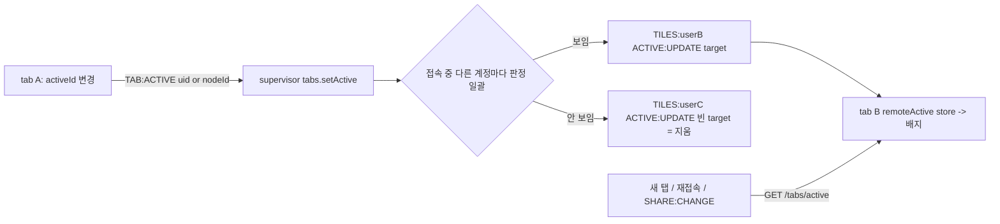

# REF — active 타일 표시 · 위치 번호 단축키

> 2026-10-12 신설. 확정된 표시 방식(2026-10-06) → `REF-node-ui-overview.md` "active 타일 표시" / 시안 → user vault `user/links.md`(https://claude.ai/artifact/GjJjsxjrmZMRKFYSrY59HY) / 이력 → `history/node-ui-active.md` / 현재 → `CURRENT.md`

**상태(2026-10-12): AT1(상태 위치)~AT6(이동할 때 같이 할 일) = 제안대로 확정·구현, 활성-1(상태·누르기)~활성-5(확인) 완료(헤드리스 13/13, 커밋 전). RA1(맞추는 기준)~RA6(순서, 다른 계정 active 배지) = 사용자 결정 대기.**

## 이미 정한 것 (2026-10-06, `REF-node-ui-overview.md`)
| 항목 | 확정 |
|---|---|
| active의 뜻 | 마지막으로 누른 타일 = 키 입력 대상. 터미널이면 그 xterm에 포커스 |
| 표시 | 나(약하게 흐림): active 테두리·머리 줄 `primary` + 나머지 불투명도 낮춤(시안 0.70) |
| 처음 상태 | active 없음 = 흐림 없음 |
| 범위 | 탭마다, 서버 저장·계정 동기화 없음 |
| 전체보기 | 같은 방식으로 강조 |
| ⑮(모바일 가상 키보드) | 특수 키 줄 = active 터미널로(특수 키 줄 자체는 아직 코드 없음 — 이번 범위 밖, active만 쓸 수 있게 둠) |
| 단축키 | 위치 번호로 active 전환(시안 `Alt+숫자`). 키 조합은 구현 때 확인 |

## 지금 코드 (2026-10-12)
| 자리 | 있는 것 |
|---|---|
| `tileGrids.store.ts` | `order`(최소화 제외 배치 순서) · `posOf`(타일 id → 위치 번호 1부터) · `grids` · `reveal(tileId)`(화면 밖 Grid면 스크롤) · `overview` |
| `TileStrip.vue` | `window` keydown: 전체보기 `Esc` / 전체보기 타일 Enter·Space |
| `TileFrame.vue` | 루트 `TileFrame--{type}`·`--overview`(폴더 0.72 흐림)·`--shared`(공유 테두리) |
| `processTerm.store.ts` | xterm `handles`(uid → term, 반응형 밖) · `attachCustomKeyEventHandler(clipboardKeys)`(Ctrl+C 복사·Ctrl+V) |

## 정할 것 (AT = active 타일)
| 결정 | 묻는 것 | 제안 |
|---|---|---|
| AT1(상태 위치) | active를 어디에 두나 | `tileGrids.store`에 `activeId`(보드 화면마다 1개, 탭 메모리). 그 타일이 닫히거나·최소화되거나·다른 보드로 옮겨지면 null(= 흐림 해제). 보드를 바꾸면 null |
| AT2(active가 되는 때) | 누르기 말고도 active로 만들까 | **누르기(타일 안 `pointerdown`, capture) + 단축키 + 이 탭에서 내가 연 타일(새 타일·실행·내 보드에 열기 → `reveal`하는 곳)**. 다른 탭·다른 계정 때문에 생긴 타일은 active로 안 만듦(보던 것을 빼앗지 않게) |
| AT3(표시) | 흐림·강조를 어떻게 | active가 있을 때만 나머지 `opacity: 0.70`(hover 때 0.85). active = `outline`(primary, 공유 테두리와 겹쳐도 둘 다 보이게 border 대신 outline) + 머리 줄 아래선 primary. 전체보기에선 기존 폴더 0.72 흐림 대신 같은 규칙 |
| AT4(단축키 조합) | 어떤 키로 | **2026-10-12 `Ctrl+Alt+숫자`로 확정**(사용자: 동작 확인 뒤 변경). 처음 제안: `Alt+1~9`(시안 그대로), xterm 포커스 중에도 가로챔(`attachCustomKeyEventHandler`에서 false). 위험: ① Linux Chrome·Firefox의 `Alt+숫자` 탭 전환 — 페이지가 `preventDefault`로 막을 수 있는지 구현 때 실측, 못 막으면 AT4를 `Ctrl+Alt+숫자`로 ② irssi·weechat 등 `Alt+숫자`를 쓰는 터미널 프로그램엔 못 보냄(받아들임). 대안: 접두 키(tmux식 `Ctrl+\`` 다음 숫자) — 겹침은 없지만 두 번 눌러야 함 |
| AT5(10번 이상) | 위치 번호 10 이상 | **`Alt`를 누른 채 숫자 두 개 연속(1초 안) = 두 자리**(`Alt+1`,`Alt+2` → 12). 한 자리 번호와 겹치면(1 다음 2가 올 수 있는데 12가 없음) 첫 숫자에서 바로 이동, 12가 있으면 1초 기다림. 더 단순한 대안 = 1~9만 |
| AT6(이동할 때 같이 할 일) | 단축키로 바꾼 뒤 | 화면 밖 Grid면 `reveal`로 스크롤 + 터미널이면 xterm `focus()`, 폴더면 타일 요소에 포커스(xterm 포커스 해제). 전체보기 중이면 전체보기를 나가며 그 Grid로(`leaveOverview(gi)`) |

## 다른 계정의 active 위치 표시 (2026-10-12 사용자 제안, RA = remote active)
- 사용자: "다른 계정의 active 위치를 타일별로 한 글자 + 색으로 볼 수 있나" → 가능. 단 **타일 트리는 계정마다 따로**라 타일 id로는 못 맞춤 → 두 계정이 함께 가진 것으로 맞춤
- **RA 시안(2026-10-12)**: https://claude.ai/artifact/Nraz8RdacfeXkVJWGsW9nu — Main(보드 화면 2×2, 내 active + 다른 계정 배지) · Detail(1명 / 3명 / +N 툴팁 / 공유 머리 줄 / 좁은 타일 / 전체보기 라벨 / 계정 색 6개). 계정 색 = primary·share·success와 안 겹치는 6색
- 토대는 이미 있음: 탭 레지스트리(`tabs.go`, 탭마다 보는 보드 `TAB:VIEW`) + presence(공유-f, 볼 수 있는 계정 판정)

| 결정 | 묻는 것 | 제안 |
|---|---|---|
| RA1(맞추는 기준) | 다른 계정의 active를 내 어느 타일에 표시하나 | 터미널 = **process uid**(같은 uid의 내 터미널 타일) / 폴더 = **nodeId**(그 노드를 보여 주는 내 폴더 타일 전부). 폴더 uid(FU2)는 공유로 이어진 타일에만 같아서 기준으로 안 씀 |
| RA2(보내는 것) | 브라우저 → 서버 | active가 바뀔 때만 `TAB:ACTIVE {uid}` 또는 `{nodeId}` 또는 `{}`(해제). 서버는 탭 레지스트리에 메모리로만 둠(DB 없음). 탭이 끊기면 해제 |
| RA3(받는 범위·경로) | 누구에게 어떻게 | 그 process/노드를 **볼 수 있는 계정**에만(판정 = 공유 판정 함수). 터미널 = 이미 구독 중인 `PROCESS:<uid>` 토픽 / 폴더 = 볼 수 있는 계정의 계정 토픽 `TILES:<userId>`(NODE 토픽은 열린 질문 4라 안 씀) |
| RA4(표시) | 한 글자·색 | 머리 줄 오른쪽 작은 원 배지: **닉네임 첫 글자 + 계정 색**. 색 = user id로 고르는 테마 색 몇 개(hex 금지 규칙 → 테마에 색 이름 등록). 같은 타일에 여러 명이면 배지 나란히(3명 넘으면 "+N"). hover = 닉네임 |
| RA5(대상 계정) | 다른 계정만? | **다른 계정만**(내 다른 탭은 표시 안 함 — 내 화면이 내 배지로 어지러워짐). 원하면 내 다른 탭도 흐린 배지로 |
| RA6(순서) | 언제 하나 | 로컬 active(활성-1~5) 먼저 → 그 위에 활성-6(서버 `TAB:ACTIVE`·전달)·활성-7(배지) 추가. 로컬 active가 있어야 보낼 값이 생김 |

## 구현 (2026-10-12, 활성-1(상태·누르기)~활성-4(단축키))
| 자리 | 한 것 |
|---|---|
| `tileGrids.store.ts` | `activeId` + `setActive`(누르기, 포커스는 브라우저에 맡김) + `activate`(단축키·내가 연 타일: nextTick 뒤 active + 전체보기면 `leaveOverview(gi)` 아니면 `reveal` + 포커스). `posOf`에서 빠지면·`hash`가 바뀌면 null |
| `processTerm.store.ts` | `focus(uid)` — xterm이 DOM에 붙었을 때만, 붙었으면 true(아니면 타일 요소에 포커스) |
| `TileFrame.vue` | `tabindex=-1` + `data-tile-id` + `@pointerdown.capture` + `--active`(outline 2px primary, offset 1px / 전체보기는 `calc(2px / var(--s))` 안쪽) · `--dim`(0.7, hover 0.85). 전체보기 폴더 0.72 흐림 제거 |
| `hook/tileShortcut.hook.ts`(신규) | window **capture** keydown에서 `Ctrl+Alt+Digit` 가로챔(Alt만·Ctrl만은 통과)(`preventDefault`+`stopPropagation`) → xterm 키 핸들러를 고칠 필요 없음(이벤트가 textarea까지 안 감). 두 자리: `d*10 > 타일 수`면 바로, 아니면 1초 대기·Ctrl이나 Alt를 떼면 바로, 없는 두 자리면 둘째 숫자를 새 첫 숫자로 |
| `TileStrip.vue` | 훅 호출 + 전체보기 타일 클릭·Enter = `activate(tileId)` |
| `reveal` → `activate`로 바꾼 곳 | `FolderTileBody`(새 타일·실행) · `TerminalListRow`(보기/열기) · `ScriptRunList`(이 보드에 있는 터미널 열기). 크기 변경(`TileFrame.setSize`)은 `reveal` 그대로 |

- **AT2에서 뺀 것**: "위치 없음" 행의 열기(`openProcessTile`) — 기본 보드 끝에 넣고 타일은 push로만 와서 응답에 tile id가 없음. 필요하면 push 받을 때 맞춰야 함
- **확인 못 한 것**: ① 터미널 xterm 포커스(그때 worker 없음) ② (해소) `Alt+숫자` 탭 전환 문제 — 사용자가 동작 확인 뒤 `Ctrl+Alt+숫자`로 바꿈 ③ 먼 Grid로 갈 때 부드러운 스크롤이 0.75초쯤 걸림(정상)

### RA 수정안 (2026-10-12, RA0(범위) = 폴더까지 확정 — 사용자 "최종적으로는 폴더 타일까지")
| 결정 | 수정안 |
|---|---|
| RA0(범위) | **터미널 + 폴더**(확정) |
| RA3(받는 범위·경로) | 노드용 "볼 수 있는 계정 목록" 쿼리를 새로 만들지 않고 **보낼 때 접속 중 계정마다 공유 판정 함수(`process_permission`/`node_permission`)로 거름** → 통과한 계정의 `TILES:<userId>`로. 터미널·폴더 같은 길(`PROCESS:` 토픽 안 씀) |
| RA7(처음 받기) | `GET` 하나로: 탭 레지스트리의 active 전부 중 나에게 보이는 것(같은 판정). 새 탭·재접속·공유 변경 때 다시 부름 |
| RA1 보충 | 폴더 = 그 타일이 지금 보여 주는 nodeId. 루트(nodeId null = 계정마다 다른 목록)는 맞추지 않음. active 폴더 타일 안에서 다른 폴더로 들어가면 `TAB:ACTIVE` 다시 보냄 |

## 원격 active 구조안 (2026-10-12 구현 → 활성-8(원격 확인) 11/11 + 사용자 확인 → 파트 마감·커밋)
조사 근거: 탭 레지스트리 `tabs.go`(`browserTab`, `setView` 패턴) / `TAB:VIEW` 처리 `sizeOwner.go onTabView` / 계정 토픽 `TILES:<userId>`(소켓 연결 때 구독, `subscribe.go`) / 일괄 판정 `ListProcessPermissionMatrix(user_ids, uids)` 있음 · 노드판 없음 / 공유 바뀌면 `SHARE:CHANGE`가 이미 `TILES:<userId>`로 감 / 세션 `sess.Data` = `superdb.User`(닉네임 있음)

| 자리 | 내용 |
|---|---|
| `protocol/messages.go` | `TAB:ACTIVE`(브라우저→서버 `{uid?, nodeId?}`, 둘 다 없음 = 해제) / `ACTIVE:UPDATE`(서버→브라우저 `{key, userId, nickname, uid?, nodeId?}`) |
| `tabs.go` | `browserTab`에 `active`(대상) · `nickname`(attach 때 세션에서). `setActive(conn, target)` · `activeTabs()`(연결된 탭 중 active 있는 것). 끊기면(`detach`) 해제 발행 |
| `active.go`(신규) | `onTabActive`(구독 때 등록, `onTabView` 옆) · `publishActive(tab)`: 받는 사람 = 접속 중인 **다른** 계정 전부, 판정 일괄 → 보이면 대상 / 안 보이면 빈 대상(지움 — 이전에 보이던 사람 추적 안 해도 됨) · `GET /tabs/active`(나에게 보이는 것만) |
| `key` | 탭 id 원문은 내보내지 않음(크기 우선권 열쇠 — presence와 같은 이유) → 탭 id 해시 앞 8자 |
| 쿼리 | `ListNodePermissionMatrix`(노드판 일괄 판정, process판과 같은 모양) 신설 |
| 프론트 보내기 | `tileGrids.store`: active 대상(터미널 uid / 폴더 nodeId, 루트 = 없음) 바뀌면 `TAB:ACTIVE`, 소켓 다시 붙으면(`tabReady`) 다시 보냄 |
| 프론트 받기 | `remoteActive.store.ts`(신규, `pages/index.vue`에서 provide): `key → 대상` 맵 + `byUid`·`byNodeId`(계정별 중복 제거) · `ACTIVE:UPDATE` 반영 · 처음·재접속·`SHARE:CHANGE` 때 GET |
| 배지 | `ActiveBadges.vue`(신규) — 머리 줄 + 전체보기 라벨. 색 = 테마 `acct1`~`acct6`(user id % 6) |

구현 메모(구조안과 다른 점·세부):
- 프론트 보내기는 **바뀔 때만**(`sent` 비교). 소켓이 끊기면 `sent = '{}'`로 되돌려 다시 붙을 때 다시 보냄. `TileWorkspace`가 내려가면(보드 전환) `{}` 보냄
- 서버 `attach`가 보관 중 탭을 되살릴 때 `active`를 비움(끊길 때 이미 해제 발행) · `onTabActive(conn)`(계정 id 안 씀)
- 서버 판정에 **보내는 계정도 포함**: 자기가 못 보는 대상을 보내면 아무에게도 대상 없이 감
- `remoteActive.store` 처음 받기 경쟁: 불러오는 사이 온 `ACTIVE:UPDATE`는 응답을 쓴 뒤 다시 적용, 더 늦게 시작한 load가 있으면 이전 응답 버림. `tabReady` false면 비움
- 배지 = `ActiveBadges.vue`(3개 + "+N", hover = `title`), 테마 `acct1`~`acct6`(light·dark 따로, on-색은 Vuetify 자동). 머리 줄 = 공유 단계 표시 뒤·접속 상태 버튼 앞 / 전체보기 라벨 = 이름 뒤
- 터미널 타일이 볼 수 없게 되면(`unavailable`) 배지 안 그림

작업 단위 이름(이번에 다시 나눔): 활성-6(서버 전달) · 활성-7(배지 UI) · 활성-8(원격 확인 — 두 계정 + 공유 헤드리스)

## 작업 단위 (결정 뒤)
| 단위 | 내용 | 파일 |
|---|---|---|
| 활성-1(상태·누르기) | `activeId`·`setActive`·사라지면 null(AT1) + `TileFrame` pointerdown capture + 내가 연 타일(AT2) | `tileGrids.store.ts`, `TileFrame.vue`, `reveal` 부르는 곳 |
| 활성-2(표시) | AT3 CSS + 전체보기 | `TileFrame.vue`, `TileStrip.vue` |
| 활성-3(포커스) | `processTerm.store`에 `focus(uid)` + active 바뀌면 포커스(AT6) | `processTerm.store.ts`, `TileFrame.vue` |
| 활성-4(단축키) | window keydown(capture) + xterm 키 핸들러에서 같은 함수 + AT5 두 자리 | `TileStrip.vue`(또는 새 composable), `processTerm.store.ts` |
| 활성-5(확인) | 헤드리스: 누르기·흐림·단축키·두 자리·reveal·전체보기·xterm 포커스·브라우저 탭 전환 막힘 여부 | — |
