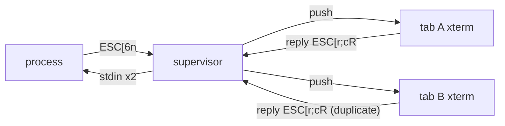

# REF — 터미널 질의 응답 중복 (파트(질의 응답 중복), 2026-10-13)

> 이력 → `history/term-query.md` / 현재 진행 → `CURRENT.md` / 발견 기록 → `REF-process-snapshot-impl.md` "스냅샷-d"

## 문제
- vim·htop 같은 프로그램은 출력에 **질의 시퀀스**(예: `ESC[6n` = 커서 위치 질의)를 넣는다. xterm은 이걸 화면에 그리지 않고 **응답 바이트**(예: `ESC[12;5R`)를 입력(`onData`)으로 돌려보낸다. 프로그램은 응답을 키 입력과 같은 통로(stdin)로 읽는다
- process 출력은 그 터미널을 연 모든 탭에 전달된다(계정 동기화) → 탭마다 xterm이 응답 → process가 응답을 탭 수만큼 받음. 남는 응답은 키 입력으로 해석됨(vim에 엉뚱한 문자·명령)

## 결정
| 항목 | 결정 |
|---|---|
| 응답하는 탭 | **크기 소유 탭만**(`owners_.value[uid]`, process마다 하나). 질의가 올 때마다 판정 → 소유권이 넘어가면 바로 따라감 |
| 막는 지점 | **질의를 처리하지 않음** — 소유 아닌 탭은 xterm parser 훅(`registerCsiHandler`·`registerDcsHandler`·`registerOscHandler`)이 `true`를 돌려줘 기본 처리(응답 생성)를 건너뜀 |
| 기각 | (나) 서버 중복 제거 — 서버에선 응답과 사용자 입력을 구분 못 함 / 처음 확정한 (가)의 "`onData`에서 응답 모양을 걸러냄" — 같은 모양의 붙여 넣은 텍스트까지 걸러짐. parser 훅은 입력 경로를 안 건드려서 이 감수가 없어짐(2026-10-13 사용자 승인) |
| 한계(감수) | 소유 탭을 닫으면 `tabGrace` 60초 동안 어느 탭도 응답 안 함 → 그 사이 질의한 프로그램은 시간 초과 후 진행. PTY 크기 우선권과 같은 규칙 |

## 막는 질의 (xterm 6 `lib/xterm.js`에서 응답을 만드는 기본 처리 확인)
| 시퀀스 | 뜻 | 비고 |
|---|---|---|
| `CSI c` / `CSI > c` | DA1 / DA2 단말 종류 | |
| `CSI n` / `CSI ? n` | DSR 상태·커서 위치 | |
| `CSI $ p` / `CSI ? $ p` | DECRQM 모드 질의 | |
| `DCS $ q` | DECRQSS 설정 질의 | |
| `CSI t` | 창 정보 보고 | 첫 인자 11·13·14·15·16·18·19·20·21만(제목 저장·복원 등은 그대로) |
| `OSC 4/10/11/12` | 색 질의 | 데이터에 `?`가 있을 때만. 색 설정은 그대로 |

## 구현
| 파일 | 내용 |
|---|---|
| `feature/process/util/xtermQuery.util.ts` | `muteQueries(term, allow)` — 위 표의 핸들러 등록, `IDisposable` 반환 |
| `feature/process/store/processTerm.store.ts` `createHandle` | `muteQueries(term, () => !!owners_.value[uid])`. 해제는 `term.dispose()`가 같이 함 |

- 복원 중 질의(`replaying`, 스냅샷 속 옛 질의)는 기존대로 `sendInput`에서 막음 — 이번 변경과 별개

## 응답-3(확인) 결과 → `history/term-query.md` 2026-10-13
