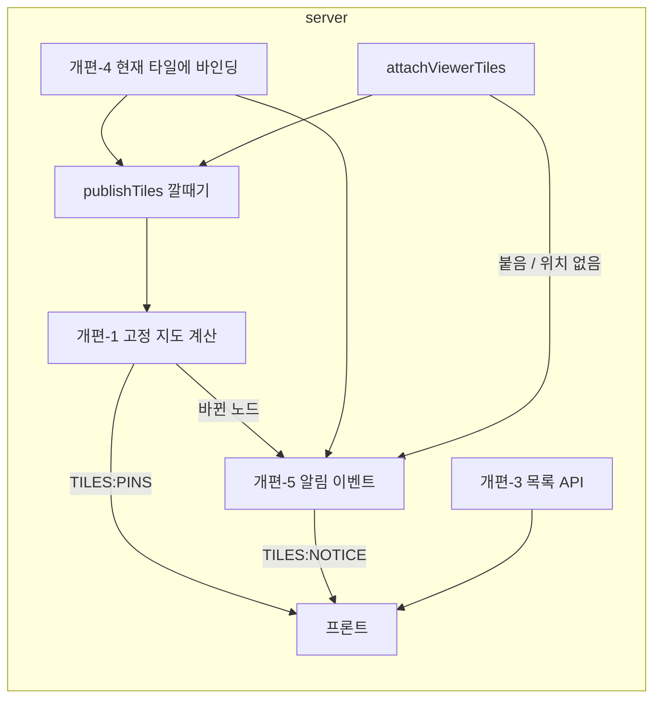

# REF — 바인딩 타일 규칙 개편 (2026-10-13~)

> `REF-tile-binding.md`(2026-10-12 구현, 커밋 전)에서 분리 — 사용자 화면 확인 전에 규칙을 다시 정함. 코드 없음. 이력 → `history/tile-binding-rework.md` / 원래 설계·구현 → `REF-tile-binding.md` / 구현·확인 → `REF-tile-binding-rework-impl.md` / 현재 진행 → `CURRENT.md`

## 결정표
명칭(2026-10-13 확정): 루트 타일의 터미널 탭 = **터미널 탭** / 폴더 타일의 스크립트 행 펼침(실행 상태 목록) = **노드의 상태 리스트** / 터미널 받는 타일로 고정 = **타일 고정**

| 항목 | 내용 | 상태 |
|---|---|---|
| 타일 고정 표시 | 폴더 노드마다 모든 보드를 통틀어 항상 하나가 고정. 첫 타일이 열리면 반드시 핀 표시(자동 바인딩도 표시 — 옛 BD7(화면) 뒤집음) | 확정 |
| R5(해제의 의미) | "고정 해제" 없음, "여기로 타일 고정"만. 고정 타일을 닫거나 다른 노드로 옮기면 다음으로 먼저 연 타일로 넘어감. 고정이 사라지는 건 그 노드 타일이 모든 보드에 없을 때뿐 → 그땐 가까운 조상의 고정 타일이 받음. 사용자 확인 예시: B1 /a 생성(핀) → B2 /a 생성(B1 유지) → B1 경로 변경(B2로) → B1 다시 /a(B2 유지, 열린 시각 새로) | 확정 |
| R1(이미 그런 것) | 터미널 탭은 루트 타일에만 — 지금도 그럼 | 변경 없음 |
| 터미널 탭 범위 | 루트 타일 경로 + 하위 경로의 process. 루트를 다른 경로로 옮기면 목록 재갱신(최소화 타일도 이걸로 다시 찾음 — R2(탭 범위 축소) 합집합안 철회) | 확정 |
| R2-a(끝난 process) | 내 타일에 있던 process = 종료돼도 목록에 나옴 / 내 타일에 없던 process = 실행 중일 때만 (터미널 탭·노드의 상태 리스트 공통) | 확정 |
| 시나리오 a·b | a: 바인딩 타일 보드(B2)를 안 보면 타일은 안 생기고 터미널 탭에만 / b: B2를 보면 타일 생성 + 터미널 탭에도 — 기존 붙이는 조건 유지 | 확정 |
| R3(경로 없는 process) | process 단독 공유는 경로를 판정할 수 없음 → **기본 루트를 보여 주는 루트 타일의 터미널 탭에만 표시**(거기서 "현재 타일에 바인딩"). 참고: process 공유를 거는 UI는 아직 없음(서버 API만, 프론트는 `MySharesDialog` 해제만) — **process 공유 UI를 둘지 말지는 나중에 결정** | 확정(2026-10-13) |
| R4(고정 표시 남발) | 고정 규칙은 그대로, **핀 표시는 같은 폴더 타일이 내 모든 보드를 통틀어 2개 이상일 때만** | 확정(2026-10-13) |
| R6(바인딩 단어 겹침) | 터미널을 타일 아래로 옮기는 명령 = **"현재 타일에 바인딩"**(사용자 명명). 폴더 쪽은 "타일 고정"이라 겹치지 않음. 기존 "내 보드에 열기" 흡수 | 확정: 이동(복사 아님, 원래 보드에서 빠짐) · 바인딩해도 타일 고정은 안 바뀜 |
| R7(가져올 위치) | "현재 타일" = 노드의 상태 리스트는 그 폴더 타일 / 터미널 탭은 루트 타일(옛 제안 "가까운 조상 폴더 타일" 대체) | 확정 |
| R8(구분 대상 불명) | ~~바인딩된 터미널 타일 시각 구분~~ — **없던 일로**(사용자). 폴더 쪽은 핀(R4)으로 충분 | 철회(2026-10-13) |
- 영향: 터미널 탭이 보드 트리 대신 "경로 하위 process 조회 + 권한 판정" 서버 API를 필요로 함
- 바인딩-1(타일 메타)~바인딩-5(프론트) 커밋 전 코드는 이 개편으로 다시 고침(`REF-tile-binding.md` "바인딩-6(확인) 항목"은 개편 뒤 다시 작성)

## 목록 행 명령 (2026-10-13 사용자 요청 — 터미널 탭·노드의 상태 리스트 공통)
명령 = **보기 / 보드로 이동** + **현재 타일에 바인딩**. 종료(■)·닫기(×)는 process 명령이라 그대로 둠(확정)

| 터미널 타일 위치 | 보기 / 보드로 이동 | 현재 타일에 바인딩 |
|---|---|---|
| 이 보드, 현재 타일 아래 | 보기(최소화면 "열기") | 숨김(이미 바인딩) |
| 이 보드, 다른 타일 아래 | 보기 | 표시 |
| 다른 보드 | 보드로 이동 | 표시(그 보드에선 빠짐 — 계정당 타일 하나) |
| 위치 없음(실행 중, 타일 없음) | 없음 | 표시(옛 "내 보드에 열기") |

## 위치 알림 (2026-10-13 사용자 요청 — 논의 중)
타일 이동 이벤트가 생기면 화면에 위치를 짧게 표시하고, 누르면 그 위치로 이동

| 이벤트 | 예 | 상태 |
|---|---|---|
| M1(내가 바인딩) | "현재 타일에 바인딩" → "B1 · 3번 위치에 바인딩됨" | 확정 포함 |
| M2(자동으로 붙음) | 다른 계정 실행 → 보는 보드에 붙음 | 확정 포함 |
| M3(다른 곳으로 빠짐) | 다른 탭·기기에서 이 보드 터미널을 B3로 바인딩 | 확정 포함 |
| M4(위치 없음) | 다른 계정 실행 · 안 붙음 → 누르면 터미널 탭 | 사용자 답 대기 |
| M5(고정 이동) | 고정 타일 닫힘 → 핀이 다른 보드 타일로 | 확정 포함 |

| 항목 | 제안 |
|---|---|
| N1(표시 수단) | **확정**: 하단 구석 토스트(몇 초 뒤 사라짐) + **알림 내역 드로어**(헤더 종 아이콘 · 안 읽은 수, 제안). 내역 = 프론트 메모리(새로고침·재접속 시 사라짐 — 사용자 허용). 서버 보관은 선택지로만(터미널 탭이 이미 위치 없음 process를 보여 줘서 이득 적음) |
| N6(내역 범위) | 내역 = 계정의 이동 이벤트 전부 / 토스트 = 출발·도착 보드를 보는 탭만(N4(받는 탭)) — 탭마다 내역이 같아짐 (제안) |
| N2(서버 이벤트) | `TILES:UPDATE`는 자기 보드 것만 받음 → 계정 토픽에 이동 이벤트(무엇·어디서·어디로) 별도 |
| N3(누르면 이동) | 보드 경로에 대상 uid → 불러온 뒤 `activate` |
| N4(받는 탭) | 출발·도착 보드를 보는 탭만 |
| N5(알림 폭주) | 같은 순간 여러 개는 하나로 묶음 |

## 구조안 (2026-10-13 제시, 승인 대기) — 결정 전부 확정 뒤 코드 조사로 작성
조사 요지: 받는 타일 판정 `bindingTile`(고정 > shownAt 가장 이른 것)은 이미 "노드마다 실효 고정 하나"를 계산함 → **고정 규칙은 서버 코드 그대로**, 바뀌는 건 표시·API·목록·알림. 모든 트리 변경은 `publishTiles` 한 곳(호출 14곳)을 지남

### 작업 단위 (개편-번호(이름))
| 단계 | 할 일 | 결정 근거 | 주요 파일 |
|---|---|---|---|
| 개편-1(고정 지도) | 계정 트리 전부에서 폴더 노드별 타일 수·실효 고정 타일(`bindingTile`과 같은 비교) 계산 → `pins = [{nodeId, hash, tileId}]`(**타일 2개 이상인 노드만**). `GET /tiles` 응답에 포함 + `publishTiles`에서 계정 토픽 `TILES:PINS`로 발행(내 탭 포함) | R4(고정 표시 남발)·R5(해제의 의미) — 프론트는 지금 보드 트리만 갖고 있어 다른 보드 타일 수를 모름 | `tile.go` |
| 개편-2(여기로 고정) | `POST /tiles/bind`에서 해제(`bound:false`) 제거 → 항상 그 타일 고정 + 같은 노드 다른 고정 풂 | R5(해제의 의미) | `tile.go` |
| 개편-3(목록 API) | ① `GET /nodes/:id/runs?deep=1` = 그 폴더 **하위 전체**(재귀) 스크립트의 process — 터미널 탭용. id 0 = 기본 루트 → **단독 공유 process도 포함**(R3(경로 없는 process)) ② 깊이와 무관하게 R2-a(끝난 process): 살아 있는 것 + **내 보드에 터미널 타일이 있는 끝난 것**. 노드의 상태 리스트(기존 `deep` 없음)도 ②를 따름 | 터미널 탭 범위·R2-a·R3 | `nodeRuns.go`, `shares.sql`(+sqlc) |
| 개편-4(현재 타일에 바인딩) | `POST /processes/:uid/tile {hash, tileId}` 확장 = 계정 트리 전부 잠금 → 어느 보드에 있든 그 터미널 타일을 빼서 지정 폴더 타일 아래로 이동(최소화 풂). 없으면 새로 만듦(옛 "내 보드에 열기"). 끝난 process는 **타일이 있을 때만** 이동 허용. 바뀐 보드 둘 다 `publishTiles`. 타일 고정은 안 건드림 | R6(바인딩 단어 겹침)·R7(가져올 위치)·목록 행 명령 | `share.go`, `tile.go` |
| 개편-5(알림 이벤트) | 계정 토픽 `TILES:NOTICE {kind, uid?, nodeId, name, from?{hash,tileId}, to?{hash,tileId}}`. kind = BIND(개편-4, M1(내가 바인딩)·M3(다른 곳으로 빠짐)은 프론트가 보는 보드로 갈라 문구) / ATTACH(M2(자동으로 붙음)) / NO_PLACE(M4(위치 없음)) / PIN_MOVED(개편-1이 이전 고정 지도와 비교 — M5(고정 이동)). 이전 고정 지도는 계정별 메모리 | 위치 알림 M1~M5 | `tile.go`, `processApi.go`, `protocol` |
| 개편-6(목록 UI) | 행 하나를 공통 컴포넌트로: 위치 표시 + [보기/보드로 이동] + [현재 타일에 바인딩] + 종료·닫기(그대로). 터미널 탭 = 루트 타일 경로로 `deep=1` 조회(루트 경로 바뀌면 재조회), 노드의 상태 리스트 = 그 폴더 타일. 실시간 갱신은 지금 `invalidateNodeRuns` 키를 같이 씀 | 목록 행 명령 표 | `RootTerminalList.vue`, `ScriptRunList.vue`, `TerminalListRow.vue`, `node.api.ts` |
| 개편-7(고정 표시 UI) | `pins` 상태(GET + `TILES:PINS`) → 핀 = `pins`에 이 타일이 있을 때. ⋮ 메뉴 "여기로 타일 고정"(고정 타일 아닌 같은 노드 타일이 2개 이상일 때만), "해제" 삭제. `FolderTile.bound` 직접 표시 중단 | R4·R5 | `TileFrame.vue`, `tileTree.store.ts`, `tile.api.ts` |
| 개편-8(알림 UI) | 알림 상태 모듈(메모리) + 하단 구석 토스트(몇 초) + 헤더 종 아이콘·안 읽은 수 → 드로어(내역). 내역 = 계정 이벤트 전부, 토스트 = 출발·도착 보드를 보는 탭만(N4·N6), NO_PLACE는 보드가 없으므로 모든 탭. 같은 순간 여러 개 묶음(N5). 누르면: 같은 보드 = `activate`, 다른 보드 = 보드 경로 + `?focus=<uid>` → 불러온 뒤 `activate`, NO_PLACE = 터미널 탭 열기 | N1~N6 | 신규 `notice.store.ts`·토스트·드로어, `AppHead`, `tileTree.store.ts` |
| 개편-9(확인) | 격리 + worker. `REF-tile-binding.md` "바인딩-6(확인) 항목" + 개편 항목 다시 작성 | — | — |

순서: 서버 개편-1~5 → 프론트 개편-6~8 → 개편-9. 의존: 6←3·4 / 7←1·2 / 8←5

### 구조안에서 정할 것 (승인 때)
| 항목 | 제안 |
|---|---|
| K1(커밋 전 코드) | 바인딩-1(타일 메타)~바인딩-5(프론트) 커밋 전 코드 위에 이어서 고치고, 개편까지 한 파트로 커밋 |
| K2(NO_PLACE 토스트) | 보는 보드가 없는 알림이라 모든 탭에 토스트 |
| K3(빠른 왕복) | 타일 경로를 바꿨다 저장 전에 되돌리면 서버는 노드가 안 바뀐 것으로 봄(shownAt 유지) — 감수 |

> 구현 메모 · 개편-9(확인) 결과 · 사용자 확인 목록 → `REF-tile-binding-rework-impl.md`
