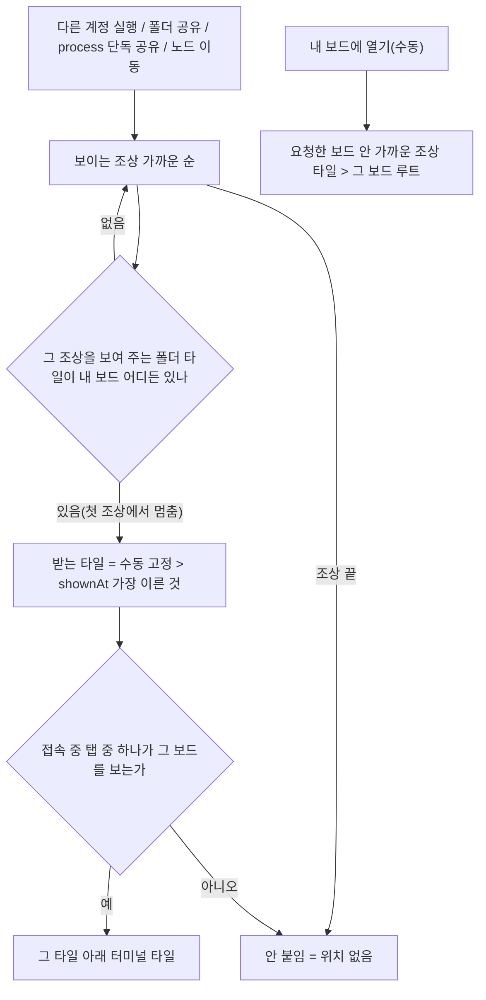
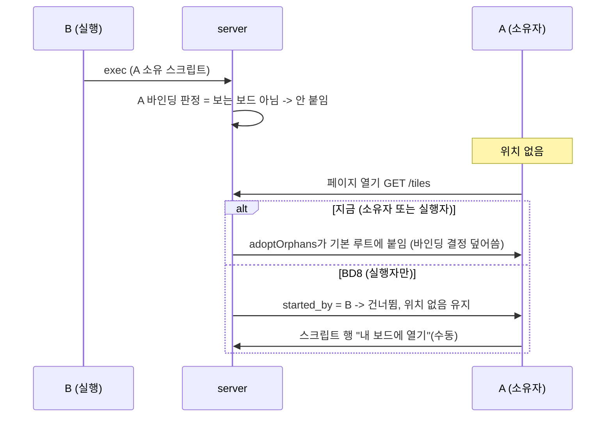

# REF — 바인딩 타일 (다른 계정이 실행한 터미널을 받는 폴더 타일)

> 2026-10-12 신설(바인딩-1(타일 메타)~바인딩-6(확인)), **2026-10-13 개편 뒤 파트 마감·커밋** — 고정 표시·해제·수동 열기·터미널 탭은 개편이 대체(→ `REF-tile-binding-rework.md`). 이력 → `history/tile-binding.md` / 지금 위치 규칙 → `REF-process-share-terminal-place.md`(`INDEX-process-share.md`) / 보는 보드 → `REF-workspace-impl.md` WS7(보는 작업 공간 전달) / **2026-10-13 규칙 개편 → `REF-tile-binding-rework.md`** / 현재 진행 → `CURRENT.md`

## 문제 (2026-10-12 사용자 테스트)
- 공유한 쪽이 실행한 터미널이 받는 쪽 **기본 보드의 공유받은 폴더 타일**로만 감 — 다른 보드에 같은 폴더를 열어 둬도
- 원인: `placeTerminal` 순서 ① 실행한 타일과 uid가 이어진 타일(FU2(공유 때 받는 쪽 uid) — 공유 때 받는 쪽 타일은 기본 보드 루트에 생김, SH2(받는 쪽 화면 위치)) → ② 가까운 조상 nodeId 타일, **보드 id 순**(기본 보드가 가장 먼저) → ③ 기본 루트. "기본 보드 우선"은 결정이 아니라 순서 고정의 부작용

## 확정 (2026-10-12 사용자)
| 항목 | 결정 |
|---|---|
| 적용 대상 | **다른 사람이 실행한 터미널만**. 내가 실행한 건 지금처럼 누른 타일(Q3(문제의 정체)) |
| 기본 바인딩 | 폴더 노드마다, **내 모든 보드를 통틀어 그 노드를 처음 연 폴더 타일**. 처음 타일을 열면 그 타일로 바뀜, 더 열어도 그대로 |
| 붙이는 조건 | **웹에 접속 중 + 지금 보는 보드에 바인딩 타일이 있을 때만** 터미널 타일을 넣음 |
| Q6(기본 루트의 접근 조건) | 공유 타일(루트 제외)이 하나도 없으면 **안 붙임** → "위치 없음"(스크립트 행 "실행 중 N"에서 "내 보드에 열기") |
| Q1(늦게 붙이기) | **안 함** — 실행 때 조건이 안 맞았으면 나중에 그 보드를 열어도 자동으로 안 붙임. 직접 "내 보드에 열기" |
| Q4(바인딩 타일을 닫으면) | 남은 타일 중 가장 먼저 연 타일, 없으면 위 Q6 |
| Q5(수동 고정) | 둠 — 사용자가 고른 타일이 있으면 최우선 |
| 루트 터미널 탭 | 지금대로(이 보드 트리의 터미널 타일만). 타일 없는 process는 스크립트 행에서만 보임 |

## 제안 BD (2026-10-12 제시, 위 확정과 합쳐 구조안으로 정리할 것)
| BD | 내용 | 상태 |
|---|---|---|
| BD1(우선순위) | 수동 고정 → 처음 연 타일 → (없으면 안 붙임). 기존 ① uid 연결·② 보드 id 순은 바인딩 판정 뒤로 밀리거나 빠짐 — 구조안에서 정리 | Q6·Q5로 사실상 확정 |
| BD2(바인딩 단위) | 계정 × 폴더 노드마다 하나. 중첩 폴더면 터미널 쪽 가까운 조상 | 권장안 |
| BD3(저장 위치) | 폴더 타일 JSON 필드: 처음 연 시각 `openedAt`(서버가 `marshal`에서 uid 발급할 때 같이) + 수동 고정 `bound` | 권장안 |
| BD4(설정 방법) | `POST /tiles/bind {hash, tileId}` — 계정 트리 전부 잠금 후 같은 노드의 다른 고정 해제. `putTiles`는 프론트가 보낸 `bound`·`openedAt` 무시(저장본 유지, `keepFolderUIDs`와 같은 방식) | 권장안 |
| BD5(적용 범위) | 다른 계정 실행(`attachViewerTiles`)·공유 걸 때 붙는 터미널·노드 이동 — `placeTerminal`을 지나는 곳. "내 보드에 열기"(수동)는 바인딩 조건 없이 엶(확인 필요) | 구조안에서 |
| BD6(공유 폴더만?) | 모든 폴더 타일(내 폴더를 공유받은 사람이 실행한 터미널도 같은 길) | 권장안 |
| BD7(화면) | 폴더 타일 보드 메뉴(⋮) "터미널 받는 타일로 고정/해제" + 머리 줄 핀 아이콘 | 권장안 |

## 구조안 (2026-10-12 제시 · 2026-10-12 전부 권장안대로 승인) — 위 확정 + BD 제안을 합침

### 결정 (BD 번호 유지)
| 결정 | 권장안 | 다른 안 |
|---|---|---|
| BD1(우선순위) | 수동 고정 → 처음 연 타일 → 안 붙임. 기존 ① uid 연결(FU2)·② 보드 id 순·③ 기본 루트는 **다른 계정 실행에서 제거**(공유 때 생긴 타일은 보통 처음 연 타일이라 결과 같음) | ①을 남겨 처음 연 타일 앞에 둠 |
| BD2(바인딩 단위) | 계정 × 폴더 노드. 가까운 조상부터 보고 **타일이 있는 첫 조상에서 멈춤** — 그 보드를 안 보고 있으면 더 먼 조상으로 넘어가지 않고 안 붙임(받는 타일이 노드마다 하나로 정해짐) | 안 보는 보드면 다음 조상으로 넘어감 |
| BD3(저장 위치) | 폴더 타일 JSON에 `shownAt`(그 타일이 **지금 노드를 보여 주기 시작한 시각** — 새로 열기·타일 안 이동 모두) + `bound`(수동 고정). 노드가 바뀌면 둘 다 초기화 | `openedAt`(타일 생성 시각) — 타일 안 이동을 못 셈 |
| BD4(설정 방법) | `POST /tiles/bind {hash, tileId, bound}` = 계정 트리 전부 잠금 → 같은 노드의 다른 고정 해제 → 바뀐 보드 저장·`TILES:UPDATE`. `putTiles`는 프론트가 보낸 `shownAt`·`bound`를 믿지 않음(저장본 유지 — `keepFolderUIDs` 확장) | 프론트가 트리에 써서 저장 |
| BD5(적용 범위) | 자동 = exec 다른 계정(`attachViewerTiles`)·폴더 공유(`attachSharedTerminals`)·process 단독 공유·노드 이동 / **수동 "내 보드에 열기" = 요청한 보드(`{hash}`) 안 가까운 조상 타일 → 없으면 그 보드 루트**(바인딩·접속 조건 없음) | 수동도 바인딩 따름 |
| BD6(공유 폴더만?) | 모든 폴더 타일 | 공유받은 폴더만 |
| BD7(화면) | 폴더 타일 ⋮ 메뉴 "터미널 받는 타일로 고정 / 고정 해제" + 머리 줄 핀 아이콘(**고정만 표시**, 자동 바인딩은 표시 안 함). 루트 목록 타일(nodeId null)은 고정 불가 | 자동 바인딩도 표시 |
| BD8(고아 안전망) | 대상 = **내가 실행한 것만**(`started_by`). 지금은 소유자도 대상이라, 남이 실행해 "위치 없음"이 된 내 process를 다음 `GET /tiles`에서 기본 루트에 다시 붙여 버림 | 그대로(바인딩 무력화) |
| BD9(보는 보드 판정) | 접속 중 탭 중 하나라도 `viewing`이 그 보드(`""` = 기본 보드 hash로 바꿔 비교) | 마지막 active 탭만 |
| BD10(기존 타일) | `shownAt` 없는 기존 폴더 타일은 다음 저장 때 채움. 같은 값이면 보드 순 → 너비 우선 순 | 마이그레이션으로 일괄 채움 |

#### BD8(고아 안전망) 그림 — 사용자 요청으로 추가

| process | 고아 안전망 대상 | 타일 없을 때 |
|---|---|---|
| 내가 실행 | 대상 | 기본 루트에 다시 붙임(실행 직후 타일 추가 실패 대비 — 지금과 같음) |
| 내 소유, 남이 실행 | **대상 아님(바뀜)** | 바인딩 결과, 안 붙었으면 "내 보드에 열기" |
| 공유받은 것 | 대상 아님(지금과 같음) | 바인딩 결과 |

- 결과가 바뀌는 곳: process 단독 공유는 받는 쪽이 폴더를 못 보는 경우가 많음 → 지금은 기본 루트, 이제 **위치 없음**(Q6(기본 루트의 접근 조건)과 같은 규칙)
- 한계: 타일을 다른 보드로 옮기면(작업 공간 이동) 그 보드 저장본에 없던 id라 `shownAt`이 새로 찍힘 → "처음 연 타일"에서 밀릴 수 있음

### 작업 단위
| 단계 | 할 일 | 주요 파일 |
|---|---|---|
| 바인딩-1(타일 메타) | `tileItem.ShownAt`·`Bound`. `marshal`이 폴더 타일 `ShownAt` 비면 지금 시각. `keepFolderUIDs` → `keepFolderMeta`(uid는 id 기준 유지, shownAt·bound는 같은 id + 같은 nodeId일 때만 유지) | `tile.go` |
| 바인딩-2(받는 타일 판정) | `bindingTile(docs, ancestors)` + `tabs.viewedBoards(userID)`. `insertTerminal`을 자동(바인딩 + 보는 보드, 아니면 nil)·수동(지정 보드) 두 갈래로. `placeTerminal`·`sourceFolderUID`·`linkedFolderTile` 제거 | `tile.go`, `tabs.go`, `shareAccess.go`, `share.go`, `processApi.go` |
| 바인딩-3(고정 API) | `POST /tiles/bind` | `tile.go` |
| 바인딩-4(고아 안전망) | `ListOwnLiveProcesses` → `started_by = $1`만 + sqlc 재생성 | `processes.sql`, gen |
| 바인딩-5(프론트) | `FolderTile.bound` / ⋮ 메뉴 고정·해제 + 핀 아이콘 / `openProcessTile(uid, hash)` | `tileTree.store.ts`, `TileFrame.vue`, `share.api.ts`, 호출부 |
| 바인딩-6(확인) | 격리 + worker. 아래 항목 | — |

### 바인딩-6(확인) 항목 (A 소유·실행, B 조작 공유)
- B: 공유로 기본 보드에 S 타일(처음) → 보드2에도 S 열기. B가 보드2만 보는 중 A 실행 → **안 붙음**(위치 없음) / B가 기본 보드 보는 중 → 기본 보드 S 아래
- B가 보드2 S 타일 고정 → 보드2 보는 중 실행 → 보드2 아래 / 고정 해제 → 다시 처음 연 타일
- 처음 연 타일 닫기 → 다음으로 먼저 연 타일 / S 타일 하나도 없음 → 안 붙음(기본 루트 아님) / B 오프라인 → 안 붙음
- 중첩: S와 S/x 타일이 다른 보드 → S/x 스크립트는 S/x 타일 기준(그 보드 안 보면 안 붙음)
- "내 보드에 열기" → 요청한 보드 안 가까운 조상 타일, 없으면 그 보드 루트
- B가 실행한 A 소유 process: A가 조건 밖이면 위치 없음 유지(고아 안전망이 기본 루트에 안 붙임) / 내가 실행한 건 누른 타일 그대로
- 타일 안 이동으로 S를 보여 주게 된 타일의 `shownAt` = 이동 시각

## 구현 메모 (2026-10-12, 바인딩-1(타일 메타)~바인딩-5(프론트) 코드 · 바인딩-6(확인) 격리 통과)
| 단계 | 구현 |
|---|---|
| 바인딩-1(타일 메타) | `tileItem.ShownAt`(unix ms)·`Bound`. `marshal`이 폴더 타일 빈 `ShownAt`을 지금으로. `keepFolderUIDs` → `keepFolderMeta`(터미널은 둘 다 비움 / 폴더는 저장본 같은 id의 uid, 같은 nodeId일 때만 shownAt·bound) |
| 바인딩-2(받는 타일 판정) | `placeFunc` + `boundPlace(viewed)`(자동: `bindingTile` + 보는 보드) · `boardPlace(hash)`(수동: 그 보드 안 `bindingTile`, 없으면 루트). `insertTerminal(…, place)`가 ok=false면 nil. `tabs.viewedBoards`, `r.boundPlaceOf(userID)`. `attachSharedTerminals`·`attachNewlyVisible`을 router 메서드로. `placeTerminal`·`sourceFolderUID`·`linkedFolderTile` 삭제, `folderTilesOf` 추가 |
| 바인딩-3(고정 API) | `POST /tiles/bind {hash, tileId, bound}` = `lockWorkspaces` → 같은 nodeId 폴더 타일 전부 `Bound = (그 타일 && bound)` → 바뀐 보드 저장·push. 루트 목록 타일 400 |
| 바인딩-4(고아 안전망) | `ListOwnLiveProcesses` = `started_by = $1`(sqlc 재생성) |
| 바인딩-5(프론트) | `FolderTile.bound` / `navigateOp`가 노드 바뀌면 `bound` 삭제(내 탭은 TILES:UPDATE를 거르므로) / `bindTile` API / TileFrame ⋮ 메뉴 "터미널 받는 타일로 고정·해제"(루트 타일도 폴더를 보여 주면 가능) + 이름 옆 핀 / `openProcessTile(uid, hash)`(ScriptRunList가 지금 보드 hash) |
- 확인: `go build`·`go vet`·`vue-tsc` 통과
- 서버 쪽 보드 이동·분리(`moveWorkspaceFolder` 등)는 tileItem을 그대로 옮겨 `shownAt`·`bound` 유지 → 위 "한계"(작업 공간 이동 시 shownAt 새로 찍힘)는 프론트 저장 경로에만 해당

## 바인딩-6(확인) 결과 (2026-10-12, 격리 실행)
- 환경: 임시 DB `nexus_bind_tmp` + supervisor 5051 + worker `NAME=bind-dev` + 격리 프론트 3001. 끝난 뒤 worker 자식(`sleep 600` 셸) 먼저 끄고 전부 끔, DB 삭제
- **API 21/21** (`bind_test.py`, A 소유·실행 / B 조작 공유, 보는 보드 = 소켓 `TAB:VIEW`): 보드2로 분리한 T2 id 유지 + shownAt T1 < T2 / 받는 타일 보드 안 보면 안 붙음 / 기본 보드 보면 처음 연 T1 / T2 고정 → 보드2 / 고정 있으면 기본 보드 봐도 안 붙음 / T1 고정 → T2 해제(노드마다 하나) / 해제 → T1 / putTiles bound 위조 무시 / T1 닫음 → T2 / S 타일 없음 → 안 붙음(기본 루트 아님) / 수동 열기 = 요청한 보드 루트·그 보드 S 타일 / 오프라인 → 안 붙음 / 중첩 x 타일 기준(S로 안 넘어감) / 타일 안 이동 → shownAt 새로·고정 풀림 / B가 실행한 A 소유 process = A 고아 안전망이 안 붙임 / A 자기 실행은 그대로
- **화면 8/8** (`pw/bind.mjs`): ⋮ "터미널 받는 타일로 고정" → 핀 + 저장본 bound → 메뉴 "고정 해제" → 핀 사라짐 / 보드2(`/w/<hash>`) 보는 중 실행 → 안 붙음 → 스크립트 행 "위치 없음" → "내 보드에 열기" → 보드2에 열림·화면에 터미널
- 테스트 함정: 보드2를 `POST /workspaces`(분리)로 만들면 그 폴더 타일이 **새 보드의 루트**가 됨(닫기 불가 → 노드 바꾸기로 대신) / 응답 `hash`는 **원래 보드**, 새 보드는 `workspace.hash` / `GET /tiles` 응답 `.tree`는 `{rootId, tiles}` — `.tiles`를 훑을 것
- 재작성 명세(scratchpad, 재부팅 시 사라짐): 위 항목 그대로

## 구현 메모(설계 단계)
- "보는 보드" = 탭 등록부의 `TAB:VIEW` hash(WS7). 접속 중 탭 중 하나라도 그 보드를 보면 조건 충족
- 붙이는 시점은 실행 때 한 번(Q1) — 지금 `attachViewerTiles`와 같은 자리
