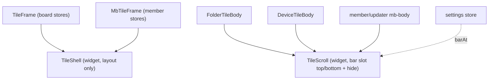

# REF — 공용 타일 틀 · 메뉴 줄 위치/숨김 · 설정 (2026-11-07 신설, 단계-2 끝 · 브랜치 `refactor/tile-shell`)

> → 이력 `history/tile-frame.md` · 설정·푸터(단계-3·4) `REF-settings-footer.md` · 타일 종류 `REF-tile-kinds.md` · 머리 줄 버튼 `REF-tile-head.md` · 찰떡 규칙 `REF-design-chaltteok.md` · 관리 페이지 모양 `REF-member-ui.md` · 진행 `CURRENT.md`

## 발단 (2026-11-07, 사용자)
- 노드 디렉토리 타일과 장비 디렉토리 타일에서 경로 줄(`.crumbs`, 경로 + 도구 + 새로/올리기)의 숨김이 다르다
  - 노드(`FolderTileBody`) = sticky 없음 -> 목록과 같이 올라가 사라짐
  - 장비(`DeviceTileBody`) = `position: sticky; top: 0` -> 고정
- 이걸 고치는 김에: 경로 줄 위치(위/아래)를 설정으로, 설정 dialog 추가, 타일 틀을 여러 페이지 공용 유틸 컴포넌트로

## 용어
| 용어 | 뜻 |
|---|---|
| 타일 | **보드 형태 페이지의 칸에 들어가는 것**(사용자 정의). 보드 타일 + 회원 관리·updater 상세 타일. 로그인·가입 `AuthTile`은 아님 |
| 머리 줄 | 타일 맨 위 줄(위치 번호·이름·창 버튼). 보드 `.TileFrame__head` 28px / 관리 `.mb-head` 36px |
| 탭 띠 | 루트 타일의 `[파일] [터미널 N]`(`RootTabs.vue`) |
| 메뉴 줄 | 본문 스크롤 영역에 붙는 도구 줄. 지금은 폴더·장비 타일의 경로 줄(`.crumbs`)뿐 |
| 아래 줄 | 관리 타일의 `.mb-foot`(저장·삭제 같은 실행 버튼 줄) |

## 합의된 결정 (2026-11-07)
| 이름 | 결정 |
|---|---|
| Q1(위/아래 고정의 뜻) | 메뉴 줄은 위 또는 아래에 붙는다. 내리면 숨김, 조금 올리면 보임, 맨 위면 항상 보임 |
| Q2(설정 범위) | 설정 저장소 하나 + 항목마다 범위(`브라우저`/`계정`). 경로 줄 위치 = 브라우저별(localStorage). 계정 범위는 첫 계정 항목이 생길 때 서버 저장을 붙임 -> 이번엔 백엔드 변경 없음 |
| Q3(공용 컴포넌트) | 타일 틀 전체를 공용화, 머리 줄도 slot |
| Q4(설정이 적용될 타일) | 모든 타일. 터미널·영상·보기 타일은 본문이 DOM 스크롤이 아니라 숨김은 해당 없음 |
| Q5(설정 dialog 여는 곳) | 로그인 뒤 모든 페이지. 푸터 오른쪽 메뉴를 페이지 공용으로 통일할 준비 |
| Q6(숨길 때 본문 높이) | 본문은 메뉴 줄 쪽(위/아래)에 메뉴 줄 **실제 높이**만큼 패딩. 메뉴 줄은 겹쳐 있다가 밀려 나가며 숨김(본문 높이 안 바뀜). 좁은 타일 = 경로 줄 두 줄 -> 높이를 재서 따라감 |
| Q7·Q9(로그인·가입 화면) | 범위 밖(보드 칸 타일이 아님) |
| Q8(작업 순서) | 단계-1 -> 단계-2 -> 단계-3·4(맨 나중) |
| Q10(루트 탭) | 탭 띠는 지금 자리 고정(스크롤 밖, 숨김 없음, 위치 설정 안 따름). 터미널 탭일 때 본문 = 터미널 목록 -> 메뉴 줄 없음 |
| Q11(메뉴 줄 slot 자리) | 메뉴 줄 slot = `TileScroll`(본문이 씀). 경로 줄 상태가 본문에 있어서 |
| Q12(관리 타일 아래 줄) | `.mb-foot`(실행 버튼 줄)은 메뉴 줄 아님 -> `TileShell` `#foot`에 아래 고정, 위치 설정·숨김 안 따름 |
| Q13(목록 패널) | `MemberList`·`UpdList` = `TileShell`(모양)만 적용. `TileScroll`·메뉴 줄 규칙은 안 씀 |

## 지금 구조 (조사 2026-11-07)
| 틀 | 쓰는 곳 | 머리 줄 | 본문 스크롤 | 메뉴 줄 |
|---|---|---|---|---|
| `TileFrame`(`feature/node/component/tile`) | 폴더·장비·터미널·보기(이미지/영상) 타일 | 28px, 위치 번호·아이콘·`#title`·공유 단계·active 배지·`#controls`·⋮`#menu`·[최소화\|크기\|×] | 본문 컴포넌트가 직접(`.FolderTileBody`·`.DeviceTileBody`·`RootTerminalList` = `overflow: auto`) | 폴더·장비 본문 안 `.crumbs` |
| `MbTileFrame`(`feature/member/component`) | 회원 상세 3종(`MemberTileView`) · updater 상세 8종(`UpdTileView`) | 36px, 위치 번호·경로 제목(`crumbs` prop)·[크기\|닫기] | 각 타일의 `.mb-body`(`styles/member.scss`) | 없음. 대신 아래 줄 `.mb-foot` |
| 직접 `.mb-tile` | 목록 패널 `MemberList`·`UpdList` | 자체 `.mb-head`(검색·필터) | `.mb-body` | 없음 |
| 따로 | `OverviewTile`(전체보기의 다른 보드) | 라벨만 | 없음 | 없음 |

### 틀이 쥐고 있는 로직 (공용 틀로 옮기면 안 되는 것 = 스토어 의존)
| 틀 | 로직 |
|---|---|
| `TileFrame` | `tileHeadActs` 등록(컨트롤 패널 창 버튼) · active/dim(`tileGrids`) · 끌기(`tileDrag`, `dragFrom`이 `.TileFrame__head` 클래스로 판정) · 보드 닫기(`boardClose`) · 크기 팝업 위치 재계산 · 키보드 띄우기(`tileFloat`) · 전체보기 라벨·`inert` |
| `MbTileFrame` | active(`memberBoard`) · 끌기(`memberDrag`) · 빈 자리 표시(`slot`) · 크기 팝업 · `requestClose` |

### 스크롤 영역에 기대는 코드 (스크롤 요소가 바뀌면 같이 고칠 것)
| 위치 | 기대는 것 |
|---|---|
| `DeviceTileBody` `onScroll` | 바닥 근처(`LOAD_MORE_PX`)면 `dir.loadMore()` — 스크롤 요소 = `bodyEl` |
| `DeviceTileBody` | 경로 바뀌면 `bodyEl.scrollTo(top 0)` · 끌어 놓기(`dragover`/`drop`, `relatedTarget` 판정) · `.dropping` 테두리 · 빈 곳 클릭(`onBodyClick`) |
| `DeviceTileBody` `.xfer` | 전송 줄 = `sticky; bottom: 0` -> **메뉴 줄을 아래에 두면 겹침** |
| `FolderTileBody` + `cellDrag.hook` | `root` = 스크롤 몸통. 칸 끌기 자동 스크롤(`scrollTop`, `EDGE`)·`.dir-grid` 찾기·떨어뜨릴 몸통 판정 |
| `tileDrag.store` `dragFrom` | 터치 끌기 시작 = `[data-pager-press]` 안 + `.DirGridCell`·`[data-pager-press-off]` 밖 |
| `.crumbs` z-index 3 | 목록 칸(dir-grid z 1~2)보다 위 — 경로 입력 자동완성 목록이 칸에 가려지지 않게 |
| `UpdFilesTile` | `.mb-body.dropping`·끌어 놓기 |

## 구조 (안)

- **`TileShell`**(공용 틀, `feature/widget/component`): 스토어를 모른다. 칸 = `#overlay`(전체보기 라벨 등) / `#head`(머리 줄) / `#tabs`(탭 띠, 고정) / 기본 slot(본문) / `#extra`(dialog 등). 바탕 모양(테두리·모서리·바탕·flex 세로)만, `:where`로 우선순위 0. prop `tag`(관리 = `section`)
  - **`#foot` 칸은 안 만듦(단계-1 때 바꿈)**: 아래 줄 `.mb-foot`의 내용·상태가 각 타일 컴포넌트에 있어(Q11(메뉴 줄 slot 자리)와 같은 이유) 틀 slot으로 올리려면 11개 타일을 쪼개야 함. 지금도 `TileScroll` 다음 형제라 스크롤 밖·아래 고정 -> Q12(관리 타일 아래 줄) 결과는 같음
  - 머리 줄 slot은 감싸는 요소 없이 그대로 그림 -> `.TileFrame__head`·`.mb-head` 요소와 scoped 스타일·`dragFrom` 판정이 쓰는 틀 안에 그대로 남음
- **`TileScroll`**(스크롤 영역): 루트 = 스크롤 요소. `#bar`(메뉴 줄, `.TileScroll__bar`로 감쌈) + 기본 slot(목록). 단계-1 prop = `tag`(회원 등록 = `form`)·`barSticky`(장비 = 고정, 폴더 = 없음 — 옛 동작 유지). 단계-2에서 `barAt`·숨김으로 바꿈
  - 스크롤 요소 잡기 = `elRef(ref)`(`feature/widget/util/elRef.util.ts`, 함수 ref -> `$el`). 본문의 `rootEl`/`bodyEl`을 그대로 채워 `loadMore`·`cellDrag` root·끌어 놓기 코드는 안 바뀜
- `TileFrame`·`MbTileFrame`은 지금 로직을 그대로 쥐고, 그리는 자리만 `TileShell` slot으로
- 메뉴 줄 slot을 틀이 아니라 `TileScroll`에 두는 이유: 경로 줄 내용(경로·선택·클립보드·입력 중)의 상태가 본문 컴포넌트에 있다. 틀에 두면 그 상태를 `FolderTile`·`DeviceTile`로 끌어올려야 함 -> Q11(메뉴 줄 slot 자리) 확정

## 단계
| 단계 | 내용 | 동작 변화 |
|---|---|---|
| 단계-1(공용 틀 리팩터링) | ①`TileShell` 만들기 ②`TileFrame`을 그 위로 ③`MbTileFrame`을 그 위로(`.mb-foot` -> `#foot`) + 목록 패널 `MemberList`·`UpdList`도 `TileShell`로 ④`TileScroll` 만들고 폴더·장비 본문 적용(`.crumbs` -> `#bar`, 스크롤 요소 교체) ⑤관리·updater 상세 타일 `.mb-body` -> `TileScroll` | 없음(폴더 = 숨겨짐, 장비 = 고정 그대로) |
| 단계-2(메뉴 줄 위치·숨김) | `TileScroll`에 위/아래·숨김 규칙. 값은 임시 상수 | 폴더·장비 경로 줄 = 같은 동작 |
| 단계-3(설정 저장소·dialog) | `settings` 반응형 모듈(항목·범위·기본값, localStorage는 try/catch) + 설정 dialog(첫 항목 = 경로 줄 위치) | 위치를 고를 수 있음 |
| 단계-4(오른쪽 메뉴 통일) | 보드 푸터 오른쪽(위치 알림·전체 화면·로그아웃 + 좁으면 더 보기)과 관리 푸터 오른쪽(계정 알약·로그아웃)을 공용 컴포넌트로 + "설정" 버튼 | 모든 페이지에서 설정 열기 |

### 단계-2(메뉴 줄 위치·숨김)에서 챙길 것
| 항목 | 내용 |
|---|---|
| 숨김 판정 | 아래로 스크롤 = 숨김 / 위로 일정 px 이상 = 보임 / 맨 위 = 항상 보임. 끝 근처 튐(관성 스크롤) 무시 |
| 숨기면 안 될 때 | 경로 입력 중(`PathInput`) · 메뉴 줄 안 팝업(v-menu) 열림 · 끌기 중 |
| 패딩 | 메뉴 줄 높이를 `ResizeObserver`로 재서 CSS 변수 -> 본문 패딩 |
| 겹침 순서 | 메뉴 줄 z-index > 목록 칸(dir-grid 1~2), 자동완성 목록이 칸 위에 |
| 아래 위치 | 장비 `.xfer`(전송 줄)와 겹침 -> 전송 줄을 메뉴 줄 바로 위에 두거나 같은 아래 묶음으로 |
| 더 불러오기 | 아래 패딩이 생겨도 `loadMore` 판정이 바닥을 맞게 잡는지 |
| 모바일 키보드 | 키보드가 열리며 높이가 바뀔 때 생기는 스크롤로 숨김이 걸리지 않게(→ `REF-mobile-viewport.md`) |

## 단계-1(공용 틀 리팩터링) 결과 (2026-11-07)
| 파일 | 바뀐 것 |
|---|---|
| `widget/component/TileShell.vue`·`TileScroll.vue`·`widget/util/elRef.util.ts` | 새로 |
| `TileFrame.vue` | 루트 = `tile-shell`(겹침·머리 줄·탭·덧붙임 = slot), 바탕 스타일은 `flex: 1`만 남김 |
| `MbTileFrame.vue` · `MemberList.vue` · `UpdList.vue` | 루트 = `tile-shell tag="section"`, `.mb-head` = `#head` |
| `FolderTileBody.vue` · `DeviceTileBody.vue` | 루트 = `tile-scroll`, `.crumbs` = `#bar`. 장비 `.crumbs`의 sticky·z-index·바탕 -> `TileScroll__bar--sticky` |
| 관리·updater 상세 타일 9개(`Member{Device,New,User}Tile`·`Upd{Device,Files,Build,Common,Trial,Run}Tile`) | `.mb-body` 요소 = `tile-scroll`(클래스 유지). `UpdStepsTile`·`UpdTextTile`은 `.mb-body` 없음 -> 그대로 |

- 확인: `type-check`·`vite build` 통과 · `scripts/check/run.sh` 125 PASS(관리·updater 화면·보드 머리 줄 끌기·크기 팝업 포함), FAIL 2 = updater 되돌리기 API 검사가 11-04 규칙 변경 전 기대값(이번과 무관, → `BACKLOG.md`)
- 보드 타일 전후 비교(격리 5051 + 임시 DB `nexus_tf_tmp` + worker `tf-dev`, master 빌드 `index-AJJLr_Z9` vs 새 빌드 `index-Dv8oEX25`, 같은 보드): 폴더·장비 타일의 경로 줄 위치·높이·머리 줄·본문 위치·스크롤 높이·스크롤 300px 뒤 경로 줄(폴더 -300 = 사라짐 / 장비 0 = 고정) **전부 같음**, 장비 타일 스크린샷 픽셀 같음(폴더는 떠 있던 Grid 알림 알약 시점 차이뿐), 콘솔 에러 없음. 정리 = 프로세스 종료·DB 삭제·worktree 제거

## 단계-2(메뉴 줄 위치·숨김) 결과 (2026-11-07)
- 방식 = **메뉴 줄을 스크롤 영역 안 sticky로**(사용자 확인). 제 자리를 차지하므로 Q6(숨길 때 본문 높이)의 패딩을 따로 계산하지 않음, 두 줄이 돼도 맞음
- `TileScroll` 구조: 루트(스크롤, flex 세로) = `[위 메뉴 줄] .TileScroll__body(flex 1 0 auto) [아래 메뉴 줄]`. 본문 감싸개 덕에 목록이 짧아도 아래 메뉴 줄은 바닥
- prop: `barAt`(없으면 `widget/util/tileBar.util.ts`의 `tileBarAt` — 단계-2 때 임시 `'top'`, 단계-3에서 설정값으로 바꿈 → `REF-settings-footer.md` "구현 결과") · `barHide`(기본 true) · `barPin`(폴더 = 경로 입력 중 \|\| 칸 끌기 중, 장비 = 경로 입력 중)
- 숨김 규칙
  | 상황 | 메뉴 줄 |
  |---|---|
  | 맨 위 | 항상 보임 |
  | 아래 위치에서 맨 끝 | 보임(제 자리가 드러나므로) |
  | 내림 | 제 높이보다 더 내려간 뒤에만 숨김(빈 자리가 안 드러나게) |
  | 올림 | 같은 방향으로 24px(`SHOW_PX`) 이상이면 보임 |
  | 붙잡힘 | `barPin` · 메뉴 줄 안 포커스 · 메뉴 줄 안 팝업 활성자 `aria-expanded="true"` = 안 숨김 |
  | 높이 변화로 생긴 스크롤 | 무시(모바일 키보드·타일 크기). 기준 높이는 처음 그릴 때 잡음 — 안 잡으면 첫 스크롤을 놓침(확인 중 실제로 걸림) |
- 함께 옮긴 것: 2px 로딩 줄 `.bar`를 메뉴 줄 안으로(같이 움직임) · 경로 줄 테두리 = `TileScroll`이 위치에 맞춰(위 = 아래 테두리, 아래 = 위 테두리, 아래 위치는 `column-reverse`라 로딩 줄이 목록 쪽) · 장비 전송 줄 `.xfer` `bottom: var(--tile-bar-bottom)`(아래 위치에서 메뉴 줄 바로 위, 숨기면 0) · `PathInput` 자동완성 = 아래 위치면 위로 열림
- 확인(격리 5051, 위/아래 각각 빌드 — 아래는 임시 값만 바꿔 빌드 후 되돌림): 폴더·장비 × {맨 위 보임·위치·내림 숨김·10 올림 아직 숨김·40 올림 보임·다시 내림 숨김·맨 끝·맨 위로·경로 입력 중 고정} + 아래 위치 `--tile-bar-bottom`·자동완성 위로·짧은 목록 바닥 = **0 FAIL 두 번**, 스크린샷 확인. `run.sh` = 낡은 기대값 2건 외 통과. type-check 통과
- 함정: 헤드리스에서 아래 줄 가운데(700, 790)를 누르면 "전체" 버튼이라 전체보기로 바뀜 -> 빈 곳(1000, 300)을 누른다

## 단계-3·4(설정·푸터) → `REF-settings-footer.md`
