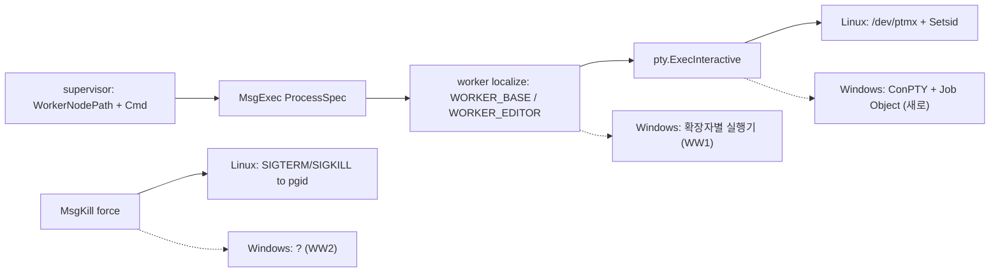

# REF — Windows worker (계획)

> 2026-10-15 신설. 파트 후보(진행 여부 미정). 이력 → `history/windows-worker.md` / EDIT·에디터 → `REF-process-exec-edit.md` / 종료 정책 → `REF-process-kill.md` / 질의 응답 → `REF-term-query.md` / 현재 진행 → `CURRENT.md`

**상태: 계획까지만 기록하고 보류(2026-10-15 사용자 "vault 기록까지만"). 코드 없음, VM 안 띄움. 결정 WW1(실행 규칙)~WW5(OS 표시) 사용자 답 대기.**

## 조사 (2026-10-15)
| 확인 | 결과 |
|---|---|
| `GOOS=windows go build ./cmd/supervisor` | 성공 |
| `GOOS=windows go build ./cmd/worker` | 실패 — **`internal/execute/pty` 한 패키지만** 안 됨(worker 의존 패키지를 하나씩 빌드해 확인). 나머지(transport·transfer·store·modernc sqlite)는 통과 |
| 실패 원인 | `execInteractive.go`: `/dev/ptmx` + ioctl(`TIOCSPTLCK`·`TIOCGPTN`·`TIOCSWINSZ`) + `Setsid`/`Setctty` + `syscall.Kill(-pgid)` + `WaitStatus.Signaled` / `execFIFO.go`: `syscall.Mkfifo`(worker는 안 씀) |
| ConPTY API | `golang.org/x/sys v0.46.0`(이미 간접 의존)에 `CreatePseudoConsole`·`ResizePseudoConsole`·`NewProcThreadAttributeList`·`PROC_THREAD_ATTRIBUTE_PSEUDOCONSOLE` 있음 → 새 라이브러리 없이 가능. Windows 10 1809 이상 |
| 실행 경로 | supervisor `WorkerNodePath` = `{WORKER_BASE}/<nodeId>/<uid>`(확장자 없음, `/` 구분) → worker가 `{WORKER_BASE}` = `os.TempDir()`로 치환. EXEC = 그 파일을 직접 실행(shebang 필수, 0755) |
| Windows에서 막히는 실행 | 확장자 없는 파일은 실행 불가(PATHEXT), shebang 모름, 실행 권한 비트 없음 |
| 에디터 | `resolveEditor` = OS `EDITOR` > `env` 파일 `EDITOR` > `vi`. Windows 64비트엔 기본 CLI 에디터가 없었음 → Microsoft Edit(`edit`, `winget install --id Microsoft.Edit`) 2025년 공개, 2025년 중반 기준 "기본 포함 예정"(지금 포함 여부 미확인) |
| 등록 메시지 | `RegisterRequest{Key, SubKey}` — worker OS 정보 없음 |

## 무엇이 OS에 묶여 있나

- 바뀌는 곳은 **worker의 `pty` 패키지 + 실행 규칙(WW1)** 이 대부분. 프로토콜·supervisor·프론트는 WW1·WW5 답에 따라 조금

## 결정 (번호-이름 대응표)
| 번호(이름) | 선택지 | 추천 |
|---|---|---|
| WW1(실행 규칙) | 가 노드 이름 확장자로 실행기 결정(`.ps1` -> `powershell -NoProfile -ExecutionPolicy Bypass -File`, `.bat`/`.cmd` -> `cmd /c`, `.py` -> `python`, 그 외 = 거절) / 나 첫 줄 shebang을 Windows 실행기로 매핑 / 다 노드에 실행기 필드(DB 컬럼) | **가** — Windows 관례와 같고 DB 변경 없음. 파일 이름에 확장자가 있어야 `cmd`가 `.bat`을 실행하므로 `WorkerNodePath` 끝에 노드 이름 확장자를 붙임(Linux도 같이 붙여도 무해) |
| WW2(종료 방식) | 종료 요청 = ConPTY 입력에 Ctrl+C(`0x03`, ConPTY가 CTRL_C_EVENT로 바꿈) / 강제 = Job Object 통째 `TerminateJobObject` | 추천대로. 강제 종료 exit code = 137(Linux SIGKILL과 같은 값, 화면 표시 통일) / Ctrl+C로 끝나면 프로그램이 준 값 그대로(보통 `0xC000013A`) |
| WW3(에디터 기본값) | 가 `edit` 고정, 없으면 실행 실패 안내 / 나 `edit` -> `nvim` -> `vim` -> `nano` 순으로 PATH에서 찾기 / 다 `env` `EDITOR` 필수 | **나** — 있는 것 중 첫 번째, 다 없으면 "worker env에 EDITOR를 설정" 오류. 같이: `$VISUAL` 읽기 + `EDITOR` 값의 인자 분리(Linux도 해당) |
| WW4(확인 환경) | 가 사용자 Windows PC / 나 VM / 다 GitHub Actions windows 러너(자동 테스트만) | **나 VM 방향**(2026-10-15 사용자 "VM으로 할 수 있어?") — 아래 "VM 준비". 실제 실행 확인은 Windows 장비 없이는 불가(여기서는 교차 빌드까지) |
| WW5(OS 표시) | 등록 때 `RegisterRequest.OS` 추가 → 장비 고르기·명부에 Windows 표시, EXEC 전에 확장자 검사(WW1 가) | 추천(작음). 안 하면 잘못된 스크립트가 worker에서야 실패 |

## VM 준비 (2026-10-15 조사, 아직 안 띄움)
| 확인 | 결과 |
|---|---|
| 가상화 | CPU 플래그 있음, `/dev/kvm` = `jh-bae` 읽기·쓰기(ACL) |
| 자원 | 메모리 31GB(가용 16GB) · 18코어 · 디스크 여유 364GB(937GB 중), docker 사용 약 26GB(회수 가능 약 7.5GB) |
| 설치된 도구 | qemu·virsh·virt-manager·VirtualBox·vagrant 없음 / docker 있음 |

| 방법 | 내용 |
|---|---|
| **가 `dockurr/windows`(추천)** | docker 안 QEMU/KVM. ISO 자동 다운로드·무인 설치, 화면 = `localhost:8006`(웹)·RDP. sudo 불필요. 설치 후 스크립트로 OpenSSH 켜면 Claude가 ssh로 worker 실행·확인 가능. 공유 폴더로 교차 빌드한 `worker.exe` 전달 |
| 나 qemu/virt-manager | `sudo apt install` + ISO 수동 설치 |

- 비용: 다운로드 약 6GB + VM 디스크 기본 64GB(실사용만큼 커짐), 메모리 4~8GB, 설치 30분 이상
- 접속: VM worker -> 이 장비 supervisor(8012는 0.0.0.0 바인드) 또는 격리 supervisor(임시 DB + 5051)
- 주의: 정품 인증 없는 Windows(테스트용, 워터마크 등) 또는 Enterprise Evaluation 90일. `dockurr/windows` 세부 옵션(버전 이름·호스트 주소)은 기억 기준 → 띄울 때 문서 확인
- 띄울 때 사용자 승인 필요(이미지 pull·다운로드·디스크 사용)

## 작업 단위 (코드 없음)
| 작업 단위 | 내용 | 파일(예상) |
|---|---|---|
| 윈도-0(빌드 분리) | `pty` 패키지를 빌드 태그로 `*_linux.go` / `*_windows.go` 분리. 공통(출력 줄 나누기 `publishLine`·`Interactive` 상태 큐)은 태그 없는 파일로. `execFIFO.go`는 linux 전용. 이 단계 끝 = Windows 빌드 통과(빈 구현) | `internal/execute/pty/*` |
| 윈도-1(ConPTY 실행) | 파이프 2쌍 + `CreatePseudoConsole` + `PROC_THREAD_ATTRIBUTE_PSEUDOCONSOLE`로 `CreateProcess`, Job Object에 넣기(자식까지 한 번에 종료). `Layout` = `ResizePseudoConsole`. 종료 대기 = 프로세스 핸들, 끝나면 `ClosePseudoConsole` 순서 주의(출력 파이프를 다 읽기 전에 닫으면 끝부분 유실) | `pty/execInteractive_windows.go` |
| 윈도-2(종료) | WW2(종료 방식) — `Kill(false)` = 입력에 `0x03` / `Kill(true)` = `TerminateJobObject(137)` | 같은 파일 |
| 윈도-3(실행 규칙) | WW1(실행 규칙) — supervisor `WorkerNodePath`에 확장자, worker `localize`에서 Windows면 확장자 -> 실행기 + `filepath.FromSlash` | `supervisor/process/path.go`, worker `router/process.go`(OS별 파일) |
| 윈도-4(에디터) | WW3(에디터 기본값) + `$VISUAL` + 인자 분리 | worker `router/process.go`, `constants/env.go` |
| 윈도-5(OS 표시) | WW5(OS 표시) — 등록에 OS, 명부·장비 고르기 표시, EXEC 확장자 검사 | `protocol/messages.go`, supervisor registry·`worker_instances`?, 프론트 |
| 윈도-6(확인) | WW4(확인 환경)에서: EXEC `.ps1`·`.bat` / EDIT 왕복 / 크기 바꾸기 / 종료 요청·강제 / 한글 출력 / 끊김·재접속 / 새로고침 스냅샷 | — |

**의존 순서**: 윈도-0 → 윈도-1 → 윈도-2 → 윈도-3 → 윈도-4 → (윈도-5) → 윈도-6. 윈도-0·윈도-4의 Linux 쪽 수정(`$VISUAL`·인자)은 Linux에서 바로 확인 가능

## 위험 · 확인할 것
- **ConPTY 출력은 원래 바이트가 아니라 다시 그린 화면**: 시작할 때 화면 지우기·커서 이동 시퀀스를 넣고, 같은 내용을 다르게 보낼 수 있음 → ring·스냅샷은 바이트 그대로라 동작은 하지만 Linux와 출력 모양이 다를 수 있음
- **시작 시 커서 위치 질의(`ESC[6n`)**: `PSEUDOCONSOLE_INHERIT_CURSOR` 플래그를 주면 ConPTY가 질의하고 응답을 기다림 → 플래그를 **안 줌**(응답할 탭이 없으면 멈춤, `REF-term-query.md` 한계와 겹침)
- 한글: ConPTY 출력은 UTF-8 VT. 다만 `cmd`의 코드 페이지(CP949)로 쓰는 오래된 프로그램 출력은 확인 필요
- EDIT 줄 끝: Windows 에디터가 CRLF로 저장하면 DB 내용 줄 끝이 바뀜 → 그 스크립트를 Linux worker에서 실행하면 문제. 처리 여부 결정 필요(확인 때 같이)
- 서비스(세션 0)로 띄운 worker에서 ConPTY 동작 — 확인 필요
- `TERM=xterm-256color` 강제는 Windows에선 의미 없음(무해)

## 메모 — worker 종료 시 자식 정리 (2026-10-15, → `REF-worker-orphan.md`)
- Linux는 안 나(SIGHUP 복원) + 안 다(정상 종료 정리)로 처리. Windows에는 SIGHUP·process group이 없음 → 스크립트를 **Job Object**(`JOB_OBJECT_LIMIT_KILL_ON_JOB_CLOSE`)에 넣으면 worker가 어떻게 죽든(crash 포함) OS가 job 안 프로세스를 전부 끔. 윈도-2(ConPTY PTY 구현) 때 같이
