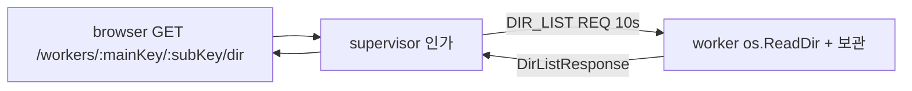

# REF — worker 폴더 타일: 폴더-1(목록 요청)·폴더-2(장비 타일)·폴더-3(여는 곳)·뒤로-1(타일 안 이동 기록)

> → `history/worker-dir-list.md` / 상위 계획 → `REF-worker-dir.md` / 다음 단계 → `REF-worker-dir-exec.md` / → `CURRENT.md`
> 2026-10-22 `REF-worker-dir.md`에서 분할(10k자 도달).

## 폴더-1(목록 요청) — 구현 끝(2026-10-22 밤, 브랜치 `feat/worker-dir`, 미커밋)

| 층 | 결정·구현 |
|---|---|
| REST | `GET /workers/:mainKey/:subKey/dir?folderId=&path=` 첫 페이지 / `&cursor=&offset=` 다음 페이지 — `cmd/supervisor/router/workerDir.go`(`mountWorkers`에 한 줄) |
| 인가 | 연 폴더 소유자(Q5(누가 열 수 있나)) + 폴더 종류 FOLDER + **그 폴더에 적용되는 device_key(상속 포함, `ResolveDeviceKey`) == mainKey**(Q12(상속 장비 폴더)) -> 아니면 403 / 인스턴스 미접속 409 |
| 프로토콜 | `internal/protocol/messages.go` `MsgDirList`·`DirListRequest{path, cursor, offset}`·`DirListResponse{path, parent, cursor, total, offset, entries, err, reason}`·`DirEntry` |
| 항목 | `name`·`path`(worker가 이은 전체 경로)·`kind`(dir·file·link·other)·`size`·`modTime`(Unix 초)·`exec` / 링크: `linkTarget`(readlink 원문)·`targetPath`(원본 절대 경로, 끊기면 없음)·`targetDir`(Q14(링크 폴더)) |
| 최상위 | 빈 path = Linux `/`, Windows 드라이브 목록(`GetLogicalDrives`, path·parent 빈 값)(Q6(처음 여는 위치)). `parent` = null이면 위 없음(Linux `/`), ""이면 드라이브 목록(Windows `C:\`의 위) |
| 페이지 | **안 다(worker 캐시)**(Q13(큰 폴더 상한)): 첫 요청에 전부 읽고 정렬(폴더·폴더 링크 먼저, 이름 소문자순)해 보관 + cursor / 500개씩 / 마지막 요청 뒤 60초 만료 / 연결당 32개, 넘으면 가장 오래 안 쓴 것부터 / 크기·시각(lstat)은 페이지를 자를 때만 채움. 보관은 **연결마다**(`workerRouter.dirs`) -> worker 재접속 뒤 cursor = expired |
| 실패 | worker `err` 코드 -> HTTP: not_found 404 · denied 403 · not_dir 400 · bad_path(상대 경로) 400 · expired 410 · other 500 / worker 응답 없음 10초 504 / RES 에러 502 |
| OS 분기 | `cmd/worker/router/dir_other.go`·`dir_windows.go` = `topListing`·`rootParent`만. 나머지는 `dir.go` |

- 인가 직후 `EndTx`(`tx.go`, 2026-10-22 사용자 요청)로 요청 트랜잭션을 커밋·닫고 worker를 기다린다 -> DB 연결 점유 없음. 이후 panic이어도 롤백할 트랜잭션 없음(읽기만 함). 멈춘 네트워크 파일 시스템이면 worker 쪽 `ReadDir` 고루틴은 끝나지 않을 수 있음(취소 불가)
- 프론트는 아직 없음 -> api 함수·`expired` 다시 요청은 폴더-2(장비 타일)에서

### 확인(2026-10-22 밤, 격리 실행 18/18)
- 격리: supervisor 5051 + 임시 DB `nexus_dir_tmp`, worker `dir-dev`(→ `REF-test-env.md` "격리 실행"). 끝나고 프로세스 종료·DB 삭제
- 스크립트 scratchpad `iso/dir_test.py`(세션 끝나면 사라짐) — 명세: 계정 2개, 폴더 `dev`(deviceKey `dir-dev`) + 하위 `child` + 장비 없는 폴더. 픽스처 폴더 = `big/`(빈 파일 1203개)·`sub/`·`linkdir -> sub`(절대)·`rel -> sub`(상대)·`broken -> ../nowhere`·`run.sh`(+x)·`locked/`(chmod 000)
- 항목: 최상위 `/` · 하위 폴더에서 열기(Q12) · 폴더 먼저 정렬 · 링크 폴더·상대 링크·끊긴 링크 · 실행 비트 · parent · 페이지 500/1203 -> offset 1000에서 203 · 없는 cursor 410 · 파일 400 · 없음 404 · 권한 없음 403 · 상대 경로 400 · 장비 없는 폴더 403 · 다른 계정 404 · 없는 인스턴스 409
- 함정: worker를 `TMPDIR=<scratchpad>/...`로 띄우면 보관 프로세스 소켓 경로가 너무 길어(>85) 시작 실패 -> worker는 기본 TMPDIR로 띄움(-env 절대 경로라 dev 판정이어도 됨). `pgrep -af 'worker -hold' | grep <경로>`는 자기 명령줄을 세므로 `/proc/<pid>/cwd`로 확인
- **못 본 것**: 504(응답 없음). Windows는 2026-10-23 VM에서 확인(아래 "Windows 확인")

## 뒤로-1(타일 안 이동 기록) — 결정(구현은 아래 "폴더-2·3 구현")
| 번호(이름) | 결정 |
|---|---|
| 뒤로-1 범위 | 장비 타일 **과 기존 폴더 타일** 둘 다, 타일 안 이전 위치로. 공통 hook |
| Q16(기록 보관 위치) | **타일 트리에 저장**(새로고침·다른 기기 유지), 타일당 20개(뒤로·앞으로 합쳐서) |
| Q17(앞으로 가기) | 같이 둔다 |
| Q19(단축키) | **Ctrl+Shift+←/→**. active 타일이 폴더·장비 타일일 때만 / 입력 칸 포커스면 안 가로챔(단어 선택) / `appShortcutsOff` 먼저. Ctrl+Alt+←/→는 이 PC GNOME 작업 공간 전환과 겹쳐 버림, Alt+←는 브라우저 뒤로(보드 전환 `router.push`)와 겹쳐 버림 |
| 마우스 뒤로 버튼 | 연결 안 함 — 지금처럼 이전 보드(사용자 확인 2026-10-22) |
| 링크 원본으로 이동 | 폴더-2에서 버튼(`targetPath`), 이동 기록에도 쌓임 |

## 폴더-2(장비 타일) 세부 설계 (2026-10-22 밤, 승인·구현 끝)
| 항목 | 설계안 |
|---|---|
| 타일 타입 | `device` = `nodeId`(연 폴더, Q15(장비 디렉토리 id)) + `instance`(`main#sub`) + `path`(지금 경로, "" = 최상위) |
| 능력 | 능력-1(루트 가능) O(실제 루트는 폴더-6(보드 이동)) · 능력-2(자식 가능) O(폴더-4(실행)의 터미널) · 능력-3(process 담음) X. 서버 `tileKinds` 줄 + check(nodeId·instance 필수), 프론트 `TILE_KINDS`·`TileType`·`ParentTile` 합집합 |
| 이동 기록(뒤로-1) | 타일 필드 `back`·`fwd`(문자열, 합쳐 20개). 폴더 = 노드 id("" = 루트 목록), 장비 = 경로. 이동마다 쌓고 앞으로 기록은 비움. 버튼 + Ctrl+Shift+←/→ |
| 컴포넌트 | `DeviceTile.vue`(TileFrame: 아이콘·장비 키·경로 끝 이름, 뒤로·앞으로, 메뉴 = 새로고침·닫기) + `DeviceTileBody.vue`(경로 줄 + 목록) + `TILE_COMPONENTS` 줄 |
| 경로 줄 | 폴더-1 응답에 `crumbs`([{name, path}]) 추가 — 프론트가 구분자를 모르는 채로 |
| 목록 | 아이콘·이름·크기(파일만)·수정 시각 / 링크 = 원본 경로 + "원본으로" 버튼 / 폴더 클릭 = 타일 안 이동 / 파일 클릭 = 폴더-4 전까지 없음 |
| 페이지 | 맨 아래 근처로 스크롤하면 다음 500개, "1203개 중 500개" / 410(expired) = 처음부터 다시 |
| 오류 | 409(끊김)·403·404 = 본문 안내 + 상위로·다시 시도. 끊김은 worker 폴링(`WORKER_POLL_MS`)으로 다시 붙으면 자동 다시 읽기 |
| 동기화 | 경로·이동 기록 = 타일 트리 -> 같은 계정 다른 탭도 따라감(폴더 타일과 같음). 목록은 탭마다 요청 |

사용자 답(2026-10-22 밤): **Q20 = 폴더-3(여는 곳) 같이** · **Q21 = 다른 탭도 따라감** · **Q22 = 원본이 파일이면 그 파일이 든 폴더로**

### 폴더-3(여는 곳) 세부 설계 (승인·구현 끝)
| 항목 | 설계안 |
|---|---|
| 버튼 자리 | 폴더 타일 경로 줄 도구 영역, 장비 칩 옆 아이콘 버튼(`mdi-folder-network`). 보이는 조건 = 이 폴더 소유자 + 적용 장비 있음(상속 포함). 접속 0이면 흐리게 + title "접속 중인 인스턴스 없음" |
| 인스턴스 고르기 | `GET /workers?nodeId=`와 같은 목록. 1개면 바로 열고, 여러 개면 기존 `WorkerPickDialog` 재사용(제목 "장비 디렉토리 열기") |
| 만들기 | 프론트 `attachOp`로 이 폴더 타일의 자식 `device{nodeId = 지금 폴더, instance, path: ""}` -> 최상위(Q6)부터 |

## 폴더-2·3 구현 (2026-10-22 밤, 브랜치 `feat/worker-dir`, 미커밋)
| 층 | 파일 | 내용 |
|---|---|---|
| 서버 타일 | `router/tileKind.go`·`tileDoc.go` | `tileDevice`(능력-1·2, check = nodeId·`#` 든 instance·uid 없음), 다른 종류는 `noDeviceFields`. 필드 `instance`·`path`·`back`·`fwd`, 기록 합 > `tileHistMax`(20) 거부 |
| 서버 테스트 | `tileDoc_test.go` | `TestValidateDevice`(거부 6가지)·`TestDeviceNotFolder`(uid 발급·`folderTilesOf`에 안 잡힘) |
| worker | `dir.go` | 응답에 `crumbs`(최상위부터, 루트 이름 = `/`·`C:\`, Windows는 앞에 path "" 칸) |
| 프론트 store | `tileTree.store.ts` | `DeviceTile`·`ParentTile` 합집합 / `NavTile`·`locOf`·`moveOp`(새 위치 = 뒤로에 쌓고 앞으로 비움)·`histOp`(누른 때 위치 `from`이 다르면 무시 = 재적용 멱등)·`openDevice`·`navigateDevice`·`goHistory`. 폴더 `navigate`도 기록을 쌓음 |
| 프론트 화면 | `DeviceTile.vue`·`DeviceTileBody.vue`·`TileNavButtons.vue`(폴더·장비 머리 줄 `#controls`)·`tileComponents.ts` | 목록·경로 줄·접속 점·새로고침·링크 원본으로·페이지(바닥 300px 전 / "더 보기")·오류(상위로·다시 시도, 409는 접속하면 다시 읽음) |
| 프론트 데이터 | `worker/api/worker.api.ts` `listWorkerDir` · `worker/hook/workerDir.hook.ts` · `worker/util/workerDir.util.ts` | 늦은 응답 = gen으로 버림, 410 = 처음부터. **실패 때 경로 줄·상위 = 요청한 경로 기준**(직전 폴더 값이 남으면 "상위로"가 한 단계 더 올라감 — 확인 중 찾은 버그) |
| 단축키 | `hook/tileNav.hook.ts`(`TileStrip`) | Ctrl+Shift+←/→, `appShortcutsOff` 먼저, 입력 칸 제외 |
| 폴더-3 | `FolderTileBody.vue` 버튼(`mdi-folder-network`, 소유자 + 적용 장비) · `nodeOps.store.ts` `openDir`·`startDir`(`pick.dir`) · `NodeOpsHost.vue` | 접속 1개면 바로, 여러 개면 `WorkerPickDialog` |
| 그 밖 | `OverviewTile.vue`(이름 = `deviceLabel`) · `nodeRemove.hook.ts`(폴더 삭제 때 그 폴더에서 연 장비 타일도 닫음) · `tileLabel.util.ts` `deviceLabel` | |

### 확인 (2026-10-22 밤)
- `go test`(router)·`go vet`·`vue-tsc`·`vite build`(scratchpad outDir) 통과
- 격리 헤드리스 22/22: supervisor 5051 + `nexus_dir_tmp` + worker `dir-dev` + vite 3001(scratchpad `iso/iso-new.mts` = 저장소 설정 정적 import 후 root·cacheDir·port만 덮음, `VITE_API_URL=http://localhost:5051`). 스크립트 scratchpad `pw/dev.mjs`(playwright-core 1.64, 세션 끝나면 사라짐)
- 항목: 폴더 타일 열기 버튼 · 최상위 `/` · 머리 줄 인스턴스 · 한 단계씩 들어가 픽스처 폴더 · 정렬 · 경로 줄 · 끊긴 링크엔 원본 버튼 없음 · 링크 원본 글자 · 원본으로 이동 · 뒤로·앞으로 버튼 · Ctrl+Shift+← · 500개 -> 스크롤로 1203 · 권한 없음 안내·경로 줄 = 요청 경로 · 상위로 · 새로고침 뒤 경로 유지 · 서버 트리(instance·path·nodeId·back) · 폴더 타일 뒤로 · 상속 폴더에도 열기 버튼 · 닫기
- 함정: 활성화하려고 `.crumbs`를 누르면 가운데 경로 버튼이 눌려 이동함 -> 머리 줄 `.name`을 누를 것 / 경로 줄 확인은 `hasText` 정규식 `^…$`(부분 일치면 옛 글자로 통과함)
- **못 본 것**: 여러 인스턴스 고르기 창, 409 뒤 자동 다시 읽기, 모바일 화면, 사용자 브라우저 확인

## Windows 확인 (2026-10-23, VM `nexus-win`)
- 준비: `docker start nexus-win`(꺼져 있었음) -> 교차 빌드 `shared/worker-dir.exe` + `shared/start-dir.ps1`(env `C:\nexus\env-dir` = `NAME=dir-win`·`WS_HOST=172.17.0.1:5051`·`SQLITE=./worker-dir.db`, 픽스처 `C:\nexus\fx` = big(1203)·sub·`junc`(mklink /J)·`slink`(mklink /D)·note.txt·run.ps1, `Invoke-CimMethod`로 ssh 밖 실행). 격리 supervisor `IP=172.17.0.1`. ssh 래퍼 = `REF-test-scripts-1014.md` "윈도-6" 방식(scratchpad `win/vssh`)
- REST 13/13(scratchpad `win/dir_win.py`): 최상위 = 드라이브 목록·crumbs `[""]` · `C:\` parent = "" · 경로 줄 `["", C:\, nexus, fx]` · 심볼릭 링크 폴더 · junction · 정렬 · 페이지 500/1203 · 400·404·상대 경로
- 화면 9/9(scratchpad `pw/win.mjs`): 경로 줄 "드라이브 / C:\ nexus / fx" · 머리 줄 이름(최상위 = main_key) · junction 원본 표시·이동 · 뒤로 · 드라이브 칸으로 최상위
- **찾아서 고친 것(`dir.go` `dirEntryOf`)**: ① junction이 `other`로 나와 들어갈 수 없었음 — Go가 Windows mount point를 irregular로 줌 -> `other`라도 `Readlink`가 되면 링크로 ② junction 원본이 자기 자신으로 나옴 — `EvalSymlinks`가 junction을 안 따라감 -> 결과가 자기 자신이면 적힌 원본(`LinkTarget`) 사용. Linux 회귀 18/18
- 함정: 화면 시험을 `http://172.17.0.1:3001`(VM이 볼 수 있는 주소)로 열면 보안 컨텍스트가 아니라 `crypto.randomUUID()`가 없어 새 타일이 안 열림(콘솔 에러만, pageerror 아님) -> Chrome `--unsafely-treat-insecure-origin-as-secure=http://172.17.0.1:3001`. 실제 서비스(https·localhost)는 해당 없음 / 정리 때 `pgrep -f "iso-172.mts"`가 자기 셸을 잡아 exit 144(알려진 함정 재발) -> 포트로 확인
- 확인 뒤 VM 끔(시험할 때만 켜는 규칙, MEMORY). 폴더-4(실행) Windows 확인 때 `docker start nexus-win` + `start-dir.ps1` 다시

## 폴더-4(실행) → `REF-worker-dir-exec.md`
