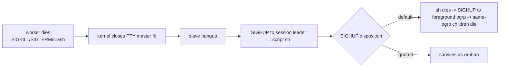

# REF — worker 종료 시 고아 스크립트

> 2026-10-15 신설. 진단 -> 결정 -> 구현 -> 고아-3(확인) -> **마감(2026-10-15, 커밋)**, 색인 → `INDEX-worker-orphan.md`. 이력 → `history/worker-orphan.md` / 현재 진행 → `CURRENT.md` / 발견 경위 → `REF-test-env.md` "끌 때 함정 — worker 자식"
> **2026-10-22 개정 → `REF-process-keep.md`**: 안 다(정상 종료 정리) 폐기 — worker 종료 신호 = worker만 끝냄(K4(기본 종료 동작)), 스크립트는 보관 프로세스(`worker -hold`)에 남는다. 안 나(SIGHUP 복원)는 worker·보관 프로세스 둘 다 유지

## 발견 (2026-10-15)
격리 확인(`pw/mid.mjs`)이 끝나 worker를 끈 뒤에도 `tick-A`·`tick-B`(무한 루프 `/bin/sh`) 4개가 몇 시간 동안 돌고 있었다(부모 = systemd user). 처음에는 "PTY `Setsid` 때문"이라고 적었는데, **재현해 보니 틀렸다.**

## 재현 (2026-10-15(2))
scratchpad에 `internal/execute/pty/execInteractive.go`의 `openPty` + `Setsid`·`Setctty` 시작 방식을 그대로 옮긴 Go 프로그램을 만들고, 부모(= worker 역할)를 죽인 뒤 자식이 남는지 봤다.

| 경우 | 자식 SigIgn | 부모 죽인 뒤 |
|---|---|---|
| 그냥 실행 · 부모 SIGKILL | 0 | **죽음** |
| 그냥 실행 · 부모 SIGTERM | 0 | **죽음** |
| `nohup`으로 실행 · 부모 SIGKILL | `...01`(SIGHUP 무시) | **살아남음** (ppid = systemd user) |
| 스크립트 안 `sleep & wait` | 0 | 죽음 |
| 스크립트 안 `trap '' HUP` | - | 살아남음 |
| 스크립트 안 `setsid cmd &` | - | 살아남음 |
| 스크립트 안 `nohup cmd &` | - | 살아남음 |

## 메커니즘

- `Setsid`·`Setctty` 때문에 오히려 PTY slave가 스크립트의 **제어 터미널**이 되고, master가 닫히면 커널이 SIGHUP을 보낸다. 즉 `Setsid`는 원인이 아니라 정리 경로다.
- 시그널 **무시(SIG_IGN)는 exec를 거쳐도 상속**된다(핸들러는 기본값으로 초기화되지만 무시는 유지). 그래서 worker를 `nohup`처럼 SIGHUP 무시 상태로 띄우면 모든 스크립트가 SIGHUP을 무시한 채 시작한다. 2026-10-15 격리 worker가 이 경우였을 가능성이 높다(그 세션의 실행 명령은 남아 있지 않음).
- 기본 상태에서도 남는 것: 스크립트가 직접 SIGHUP을 피한 경우(`trap '' HUP` · `nohup` · 다른 세션으로 `setsid`). 같은 process group(백그라운드 `&` 포함, 비대화형 sh는 job control이 없음)은 같이 죽는다.

## 살아남아도 쓸 데가 없다
PTY master는 worker 메모리에만 있다. worker가 죽으면 master가 닫히므로 새 worker가 그 스크립트에 **다시 붙을 방법이 없다**(입력·출력·크기 조절 불가, 재접속 동기화 대상도 아님). 따라서 "worker 재시작에도 작업 유지"는 지금 구조로는 성립하지 않는다. 남은 프로세스는 자원만 쓰는 누수다. 작업을 유지하려면 PTY를 worker 밖에 두는 구조(예: tmux, `internal/execute/execTmux.go`가 있으나 미사용)가 필요하다.

## 정리안 (사용자 결정 대기)
| 안 | 내용 | 막는 경우 | 비용 |
|---|---|---|---|
| 안 가(현상 유지) | 코드 안 바꿈. worker를 `nohup`으로 띄우지 말라는 운영 규칙만 | 없음(규칙 의존) | 0 |
| 안 나(SIGHUP 복원) | worker 시작 때 `signal.Notify(..., SIGHUP)`을 등록 → Go가 무시 상태를 풀고 핸들러를 설치 → exec 자식은 기본값으로 시작 | `nohup` 상속 | 몇 줄 |
| 안 다(정상 종료 정리) | worker가 SIGTERM·SIGINT를 받으면 살아 있는 process group 전부에 SIGTERM -> 유예 -> SIGKILL(`Interactive.Kill` 재사용) 후 종료 | 스크립트의 `trap HUP` | 중간(종료 순서·유예 시간) |
| 안 라(SIGKILL에도 정리) | 배포를 systemd 서비스로(기본 `KillMode=control-group`이 cgroup 전체를 끔). 또는 Linux `Pdeathsig` | `setsid`·`nohup`으로 빠져나간 손자까지(cgroup) | 배포 방식 결정 |

- Go 문서: 시작 때 SIGHUP·SIGINT가 무시돼 있어도 `signal.Notify`를 부르면 핸들러가 설치되고 더는 무시되지 않는다 → 안 나(SIGHUP 복원)의 근거.
- `Pdeathsig`는 fork한 **OS 스레드**가 끝날 때 신호가 가는 함정이 있다(Go는 스레드를 바꿔 씀) → 쓰려면 `runtime.LockOSThread` 필요. cgroup 쪽이 더 확실하다.

## 결정 (2026-10-15(2) 사용자)
- **systemd가 없는 장비도 있다**(사용자) → systemd에 기대는 안 라(SIGKILL에도 정리)는 "있으면 덤"
- 이번 파트 = **안 나(SIGHUP 복원) + 안 다(정상 종료 정리)**. 안 라(systemd)는 unit 파일 예시만
- **안 마(시작 시 청소)** = 추가 후보로 미룸: 실행 때 pgid + 시작 시각을 worker SQLite에 기록 → 다음 worker 시작 때 살아 있는 것을 끔(시작 시각 비교로 PID 재사용 회피). crash·SIGKILL 뒤 고아가 실제로 보이면 그때. 대안 Linux `Pdeathsig`(직계 자식만, OS 스레드 고정 함정)
- Windows는 Job Object `KILL_ON_JOB_CLOSE`가 위 전부를 OS 차원에서 해 줌 → `REF-windows-worker.md` 메모

## 구현 (2026-10-15(2), 미커밋)
| 번호(이름) | 결정 | 코드 |
|---|---|---|
| 종료-1(유예 시간) | SIGTERM -> SIGKILL 유예 5초, 상수 | `cmd/worker/main.go` `shutdownGrace` |
| 종료-2(최종 상태 보고) | 정상 종료 때 끝난 process는 기존 `pumpStatus` 경로로 FAILED(143/137) 보고 = PENDING이 아니라 종료로 확정. 연결이 끊긴 상태면 보고 없이 종료 | 추가 코드 없음 |
| 종료-3(두 번째 신호) | 정리 중 TERM/INT를 또 받으면 즉시 `KillAll(true)` + exit 1 | `main.go` `handleSignals` |

- `main.go` `handleSignals`: SIGHUP·SIGTERM·SIGINT 등록. **SIGHUP 등록 자체가 안 나(SIGHUP 복원)**. SIGHUP 처리는 시작 시점 상태로 가름(2026-10-15(4) 개정): `nohup`(무시 상태)으로 떴으면 무시하고 계속 / 그냥 떴으면 SIGTERM과 같이 정리 후 종료(터미널을 닫으면 worker도 끝남). 판정 `signal.Ignored(SIGHUP)`은 **`Notify` 전에** 읽어야 함(등록 뒤엔 항상 false)
  - 개정 경위: 처음엔 SIGHUP을 늘 무시 -> 사용자가 `go run`으로 띄운 터미널을 닫자 `go run`만 죽고 worker(`/tmp/go-build.../exe/worker`, 부모 systemd user)가 남아 8012에 계속 붙어 있었음. 찾기 = `pgrep -a worker` 또는 `ss -tnp | grep 8012`
- `router/shutdown.go`(신규): `admit`(종료 중이면 exec 거절 "worker 종료 중") · `Shutdown(grace)` · `KillAll(force)` · `waitEmpty`(100ms 폴링)
- **순서 의존**: `admit`의 closing 확인 + `procs.Append`는 `Shutdown`의 closing 설정과 같은 락(`WorkerState.mu`) 안. 락 밖이면 `KillAll` 직후 끼어든 process가 정리 대상에서 빠짐
- `process.go` `exec`: `procs.Append` 대신 `state.admit`(중복 uid 거절도 여기로)

## 고아-3(확인) 결과 (2026-10-15(2), 격리 5051 + 임시 DB)
| 경우 | worker 종료 | 남은 프로세스 | DB 최종 상태 |
|---|---|---|---|
| E 수정 전 worker · `nohup` · SIGKILL | 즉시 | **plain·hupTrap 둘 다 남음**(4개) | PENDING |
| B 수정 후 · `nohup` · SIGKILL | 즉시 | hupTrap만 남음(스크립트가 HUP를 직접 무시 = 알려진 한계) | PENDING |
| A 수정 후 · SIGTERM | **5.1초** | 0 | plain·hupTrap FAILED **143** / termTrap(TERM 무시) **137**(5초 뒤) |
| A 중 · 종료 1초 뒤 exec | - | - | 거절 "worker 종료 중" -> supervisor 500, 기록 FAILED **126**(기존 거절 경로) |
| C SIGINT 두 번(1초 간격) | 1.0초, exit 1 | 0 | PENDING(보고 없이 즉시 종료 — 종료-3 의도대로) |
| D SIGHUP (개정 전: 늘 무시) | 계속 돎, 스크립트도 그대로 | 0(뒤이은 SIGTERM으로 정리) | FAILED 143 |
| H1 개정 후 · 그냥 띄움 · SIGHUP | 정리 후 5.1초 | 0 | plain 143 / termTrap 137 |
| H2 개정 후 · `nohup` · SIGHUP | 계속 돎, 스크립트도 그대로 | 0(뒤이은 SIGTERM으로 정리) | FAILED 143 |

- 스크립트: plain(무한 echo) · hupTrap(`trap '' HUP`) · termTrap(`trap '' HUP TERM`)

## 안 라(systemd) unit 예시 (배포 방식을 정할 때 참고, 저장소에 파일 안 둠)
```ini
[Unit]
Description=Nexus worker
After=network-online.target

[Service]
WorkingDirectory=/opt/nexus-worker
ExecStart=/opt/nexus-worker/worker
Restart=on-failure
RestartSec=2
# KillMode=control-group(기본) = cgroup 안 전부 정리, setsid로 빠진 손자 포함
TimeoutStopSec=15

[Install]
WantedBy=multi-user.target
```
- worker는 non-dev면 실행 파일 옆 `env`를 읽으므로 `WorkingDirectory`와 무관하게 `/opt/nexus-worker/env`. `SQLITE` 상대 경로(`./worker-sqlite.db`)는 cwd 기준이라 `WorkingDirectory`가 필요. `TimeoutStopSec`은 `shutdownGrace` 5초보다 길게
